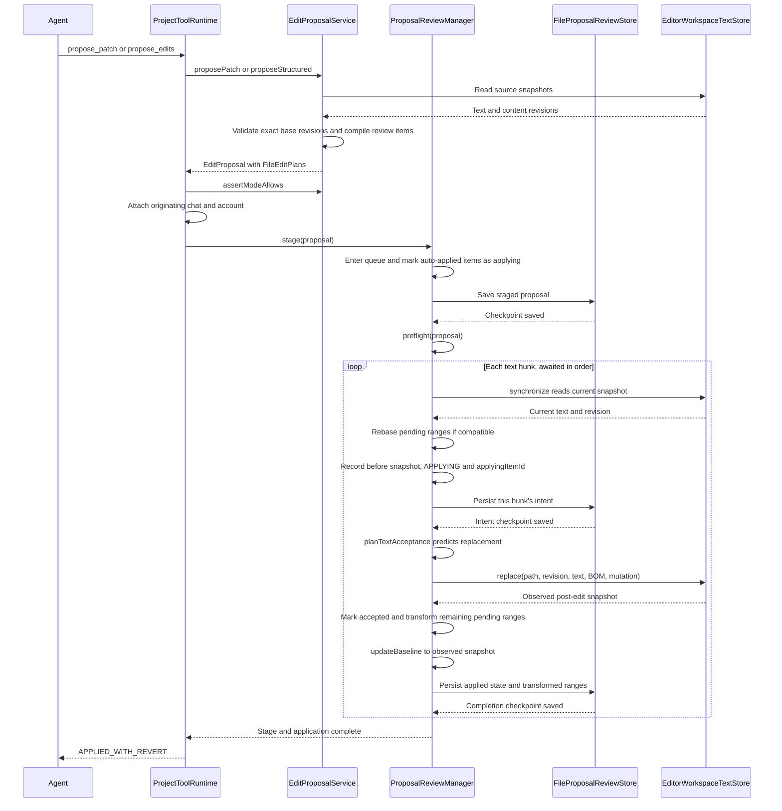
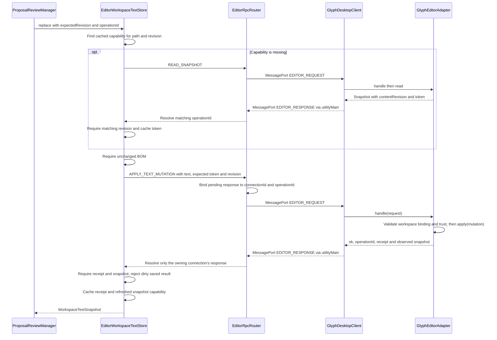
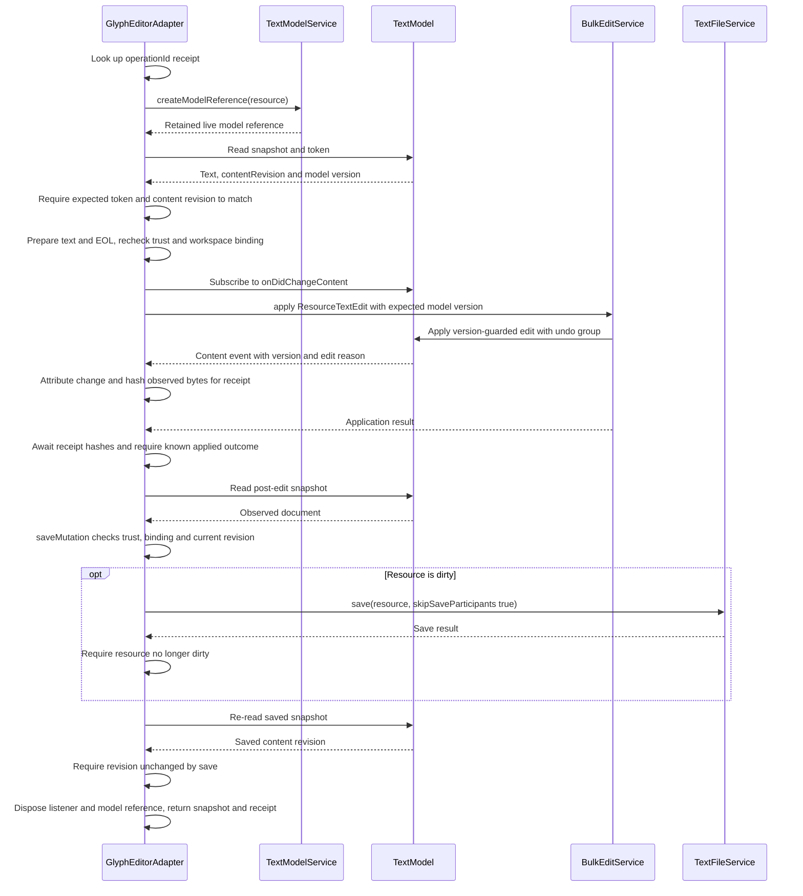

# Agent editing

Glyph applies agent edits through revision-guarded workspace operations and retains the results for Keep/Revert review. The desktop composition enables `autoApply: true` in [OpenAIDesktopRuntimeFactory](../src/desktop/host/OpenAIDesktopRuntimeFactory.ts), so these edits are reflected to the live file immediately on application, rather than being held for review. The sequences below follow an ordinary text update from the model's tool call into the live Code OSS document and back to its persisted review state.

**Note**: Structural create, rename, and delete operations use a separate renderer path, `GlyphEditorAdapter.applyFile()`.

The [agent instructions walkthrough](AGENT_INSTRUCTIONS.md) explains how scoped repository guidance and rules are disclosed before a proposal reaches staging.

The three sequences expand successive parts of the same call chain. Calls shown sequentially are awaited even where they cross a process boundary.

The first sequence follows proposal compilation and the per-hunk application loop. `ProjectToolRuntime`, `EditProposalService`, `ProposalReviewManager`, and `EditorWorkspaceTextStore` live in the utility host. `FileProposalReviewStore` owns the JSON checkpoint on disk.

The loop is the important ordering guarantee. For snapshots `S0`, `S1`, and `S2`, applying hunk 1 produces `S1` and transforms hunks 2 through N from `S0` to `S1`. Applying hunk 2 then produces `S2` and transforms hunks 3 through N from `S1` to `S2`. Hunk 3 therefore incorporates the effects of both earlier mutations. This repeats after every successful hunk.

The mechanism is [ProposalReviewManager.applyDecision()](../src/editing/reviews/ProposalReviewManager.ts), followed by `planTextAcceptance(previous, item, result.text)`, `applyTransformedRanges()`, and `updateBaseline()`. `planTextAcceptance()` selects only the remaining items whose decisions are `PENDING`. The manager also synchronizes again before the next write, allowing it to detect intervening user edits.

A proposal is not one atomic transaction across all its files and hunks. If hunk 1 succeeds and hunk 2 fails, hunk 1 remains applied and reviewable. If transforming the remaining ranges fails after a successful mutation, the manager preserves that mutation's observed result and marks the unresolved file state `STALE`.

The second sequence expands `EditorWorkspaceTextStore.replace()`. The store implements the host-neutral `WorkspaceTextStore` interface, while `EditorRpcRouter` routes requests to the owning window. The MessagePort arrows are the process boundary. `GlyphDesktopClient` and `GlyphEditorAdapter` live in the renderer.

[NativeGlyphWorkbenchService](../code-oss/overlay/src/vs/workbench/contrib/glyph/browser/NativeGlyphWorkbenchService.ts) wires `new GlyphDesktopClient(request => editor.handle(request))`. On the return path, [utilityMain](../src/desktop/host/utilityMain.ts) receives `EDITOR_RESPONSE` and calls `EditorRpcRouter.receive(connectionId, response)`. The factory's client wrapper validates filesystem access policy and qualifies paths for multi-root workspaces before forwarding requests to the router.

The mutation carries several distinct guards:

| Field                     | Meaning                                                                                                                                 |
| ------------------------- | --------------------------------------------------------------------------------------------------------------------------------------- |
| `expectedContentRevision` | The content hash must match the source snapshot used to plan this mutation.                                                             |
| `expectedToken`           | Workspace generation, resource, model incarnation, and model version must match the live editor snapshot.                               |
| `operationId`             | Identifies the attempt as `review.id:file.id:item.id`; renderer receipts prevent a repeated known operation from applying another edit. |
| `undoGroupId`             | Groups the native undo operations; the manager uses the operation ID.                                                                   |
| `save: true`              | Requests saving the changed resource before a successful result returns.                                                                |

The content revision is persisted with the proposal. Editor tokens are ephemeral capabilities and are not persisted there. Renderer mutation receipts are held in memory; they are separate from the review checkpoint and from the later review-result messages delivered to chat.

The third sequence expands a fresh `GlyphEditorAdapter.apply()` operation. It shows the normal text-edit path; a combined text and line-ending conversion uses two version-guarded `BulkTextEdits` operations in the same native undo group.

The version precondition means equality: Code OSS must still be editing the model version passed to `ResourceTextEdit`. The earlier token and content-hash checks establish that the requested source matches the inspected model. The version guard at the native edit boundary protects against changes after those checks.

For a repeated operation ID, the renderer checks its existing receipt before entering this fresh-edit path. An `UNKNOWN` receipt refuses replay. A known applied operation can return its result or finish a requested save without applying the text edit again. A transport failure alone does not prove that the mutation failed: `EditorRpcRouter` can lose its response after the renderer changed the document.

After a successful return, the manager sets `mutationCheckpointPending` and persists the observed outcome. If that save fails, it retains the outcome in memory and retries persistence before allowing subsequent queued work. The manager does not replace observed bytes with its earlier prediction.

On restart, `initialize()` loads the review checkpoint and, when workspace reconciliation is authorized, calls `reconcile()` and `reconcileApplying()`. For an interrupted text mutation, an exact expected post-edit revision establishes completion without another write. An unchanged pre-edit snapshot restores a pending, ready item for a later retry. Compatible changes can rebase pending edits; an unsafe mapping retains stale state. This is state reconciliation, not unconditional startup replay.

Stale state retention should not be confused with a complete conflict-resolution workflow. The current desktop pending-review list allows opening a stale file's preview, and `READ_PROPOSAL_FILE` has no stale-state exclusion. However, `useGlyphPendingReviewsState()` and `GlyphProposalEditor.properties()` disable Keep for stale files, and Revert still has to satisfy the manager's safety checks. There is no dedicated merge or retarget action in this path. The status text suggesting “keep this change” while Keep is disabled is an existing UI inconsistency.

Preview construction also limits what “inspectable” means: when `toGlyphProposalFilePreview()` takes its applied-text branch, it includes pending review items that have an `appliedText.after` snapshot. Unapplied hunks left behind by a partially successful proposal are not included in that branch's item list. Retaining their evidence in the checkpoint therefore does not guarantee a complete user-facing stale-proposal review.

Relevant entry points:

- [ProjectToolRuntime](../src/project/ProjectToolRuntime.ts) and [EditProposalService](../src/editing/proposals/EditProposalService.ts): tool ingestion and proposal compilation.
- [ProposalReviewManager](../src/editing/reviews/ProposalReviewManager.ts): serialized mutation lifecycle, per-hunk rebasing, persistence and recovery.
- [FileProposalReviewStore](../src/editing/reviews/persistence/FileProposalReviewStore.ts): temporary-file checkpoint write followed by rename.
- [EditorWorkspaceTextStore](../src/desktop/workspace/EditorWorkspaceTextStore.ts) and [EditorRpcRouter](../src/desktop/workspace/EditorRpcRouter.ts): host-side editor capabilities and transport.
- [GlyphDesktopClient](../code-oss/overlay/src/vs/workbench/contrib/glyph/electron-browser/GlyphDesktopClient.ts) and [GlyphEditorAdapter](../code-oss/overlay/src/vs/workbench/contrib/glyph/browser/GlyphEditorAdapter.ts): renderer dispatch, native version guards, observed receipts and saving.
- [transformTextEditRanges](../src/editing/documents/transformTextEditRanges.ts): snapshot-based range transformation.
- [useGlyphPendingReviewsState](../code-oss/ui/GlyphPendingReviews/useGlyphPendingReviewsState.ts), [GlyphProposalEditor](../code-oss/overlay/src/vs/workbench/contrib/glyph/browser/GlyphProposalEditor.ts), and [toGlyphProposalFilePreview](../src/desktop/host/toGlyphProposalFilePreview.ts): stale-state controls and preview limitations.
