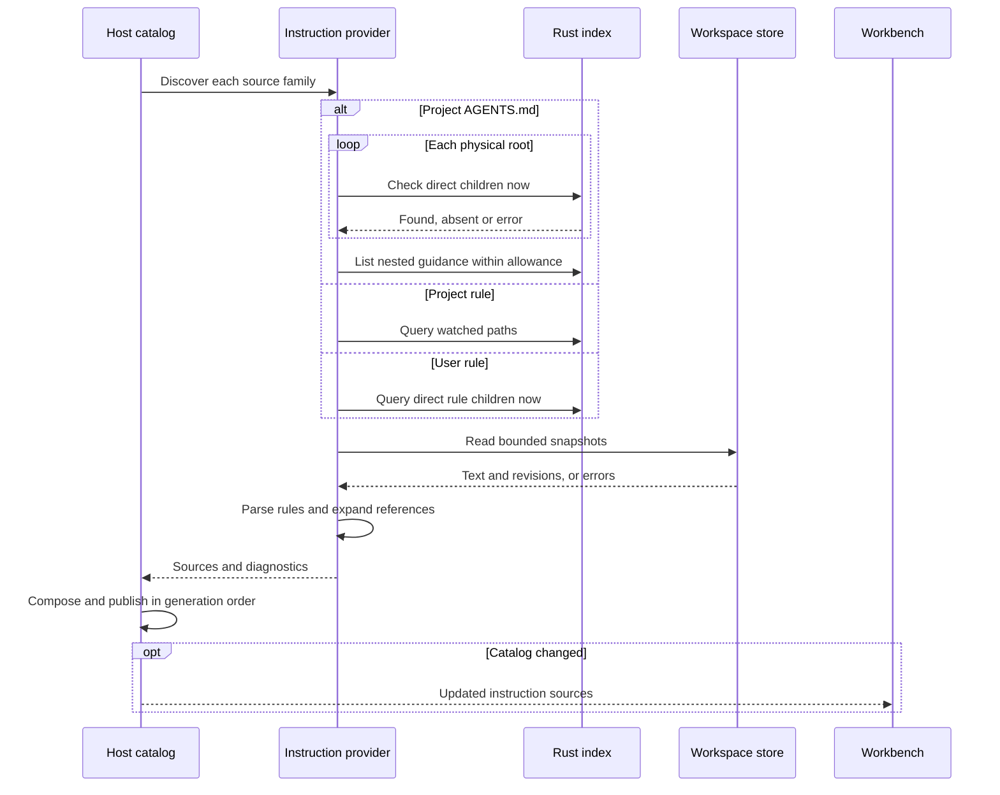
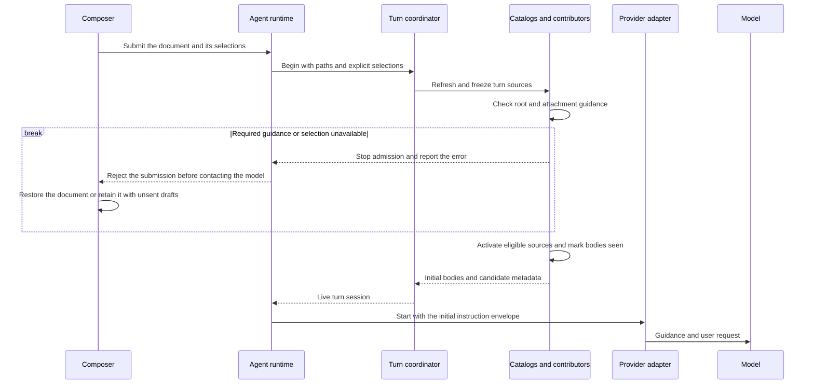
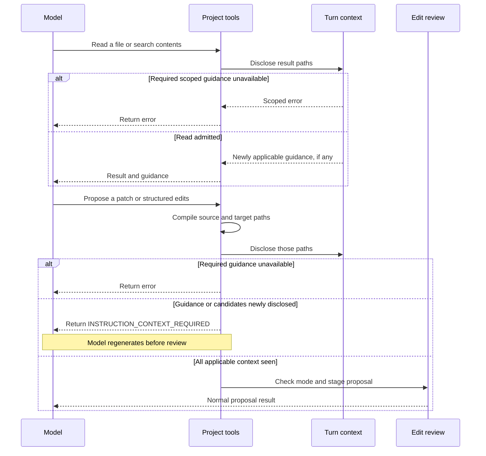
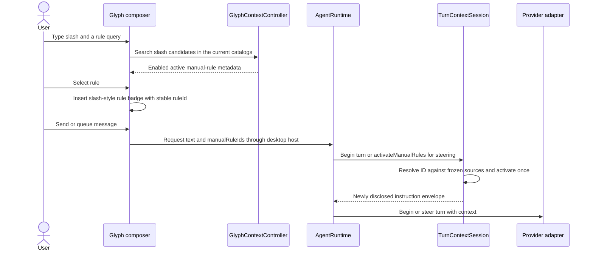
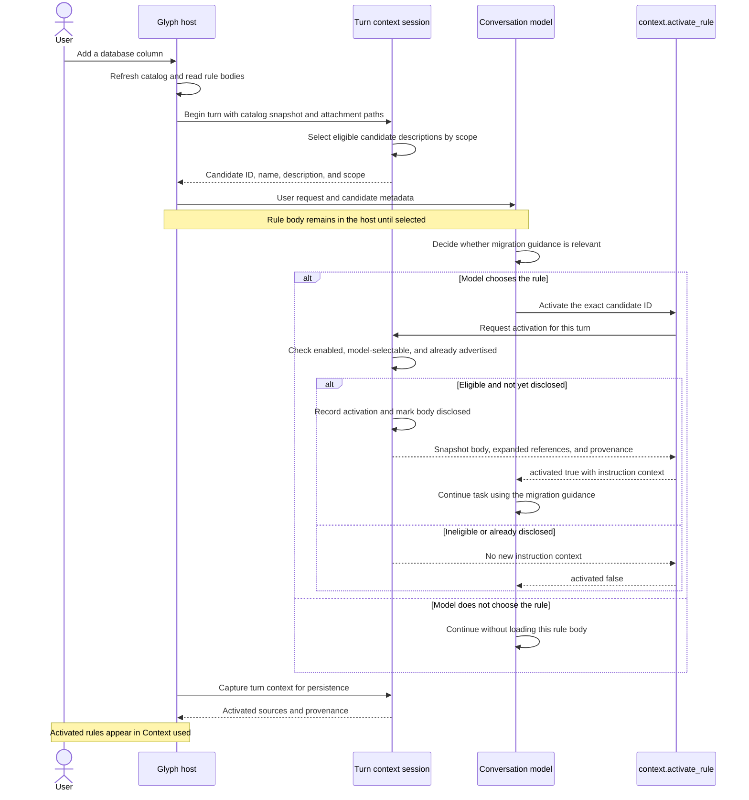
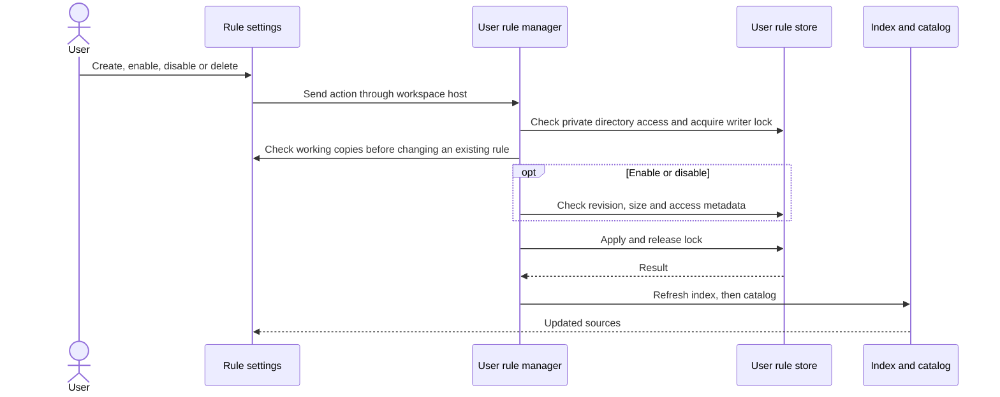
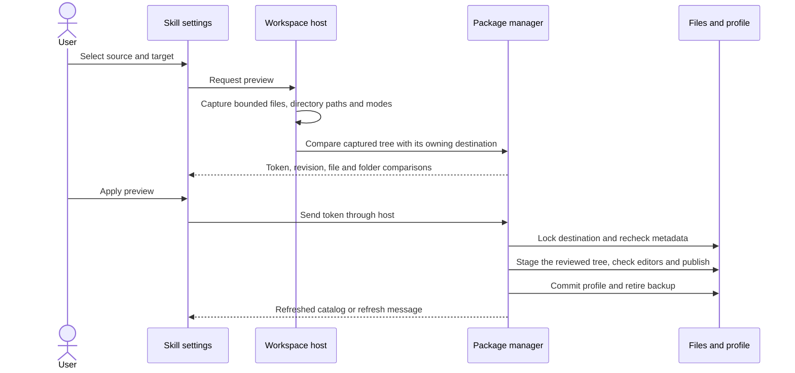
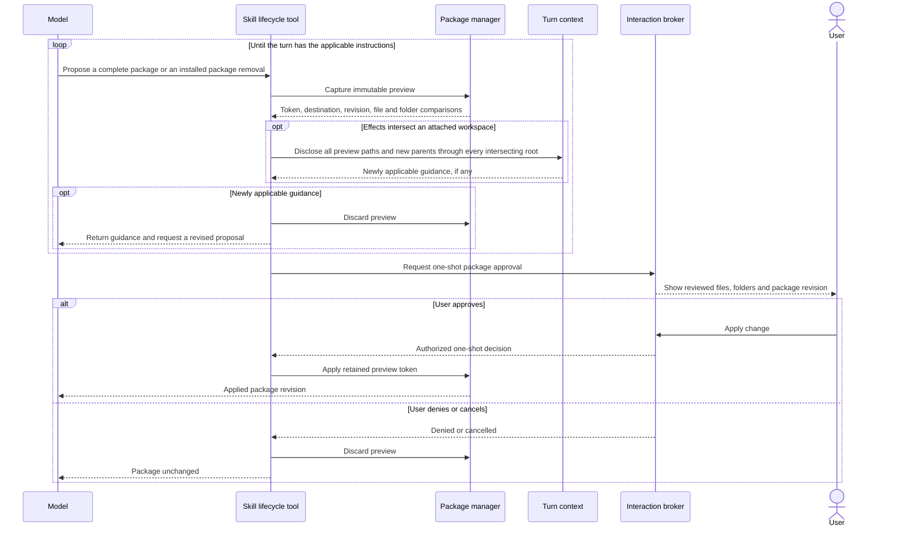
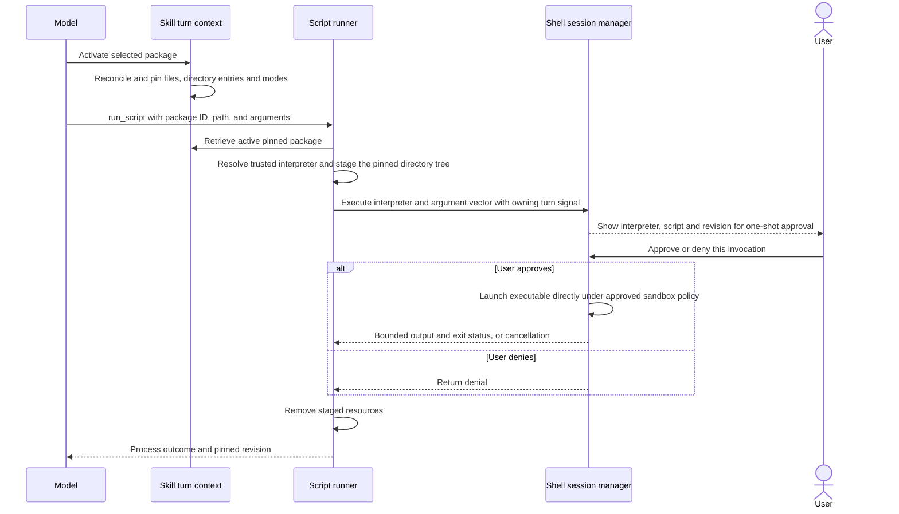
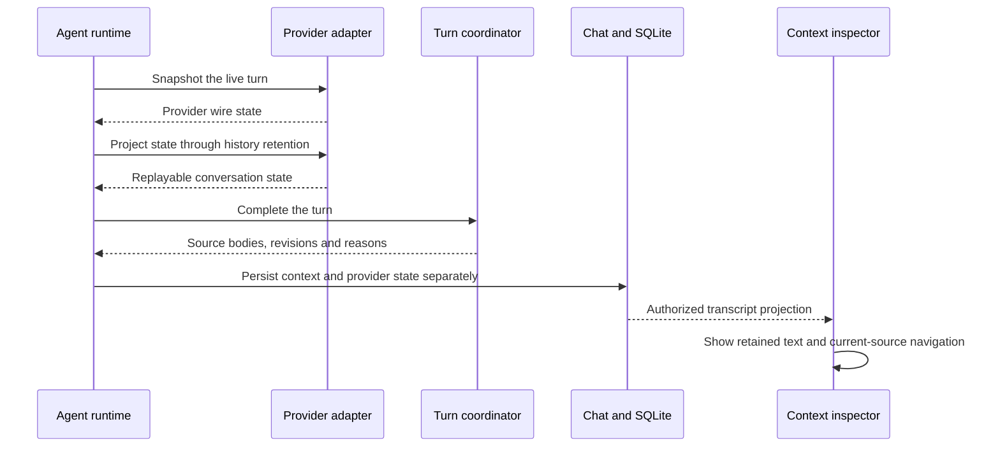

# Agent instructions

Glyph reads project guidance into a host catalog. At the start of each agent turn, it sends the model the applicable instructions and a bounded set of candidates. During the turn, a file read, attachment or explicit selection can disclose more guidance. The turn remembers which sources it has disclosed, including when two workspace paths lead to the same physical file.

The utility host owns discovery, turn coordination, project tools and persistence. The Code OSS renderer owns Settings, the composer and unsaved editor text. The provider adapter constructs the model messages. The editing flow continues after a proposal passes instruction checks. [Agent editing walkthrough](AGENT_EDITING.md)

## Sources and ownership

| Owner                                                                                     | Responsibility                                                                                                                                                   |
| ----------------------------------------------------------------------------------------- | ---------------------------------------------------------------------------------------------------------------------------------------------------------------- |
| [AgentsMdInstructionProvider](../src/instructions/AgentsMdInstructionProvider.ts)         | Discover and read directory-scoped `AGENTS.md` files.                                                                                                            |
| [AgentRuleInstructionProvider](../src/instructions/rules/AgentRuleInstructionProvider.ts) | Discover `.mdc` rules, parse activation metadata, expand references, and calculate revisions.                                                                    |
| [AgentInstructionSet](../src/instructions/AgentInstructionSet.ts)                         | Compose source families, suppress compatibility duplicates, order precedence, and resolve ancestors. This value object has no discovery lifecycle or turn state. |
| [AgentInstructionCatalog](../src/instructions/AgentInstructionCatalog.ts)                 | Refresh providers, retain the composed result, and notify subscribers when it changes.                                                                           |
| [TurnContextCoordinator](../src/context/turns/TurnContextCoordinator.ts)                  | Create, address, and release sessions by logical turn ID.                                                                                                        |
| [TurnContextSession](../src/context/turns/TurnContextSession.ts)                          | Retain the turn's source snapshot, activate applicable sources, track disclosed bodies, and record provenance.                                                   |
| [UserAgentRuleManager](../src/instructions/rules/UserAgentRuleManager.ts)                 | Create, enable, disable, and delete user rules through revision-guarded storage.                                                                                 |

[OpenAIDesktopRuntimeFactory](../src/desktop/host/OpenAIDesktopRuntimeFactory.ts) constructs these services for trusted workspaces and shares the coordinator with the provider and project tools. It registers four instruction source families.

| Family                   | Discovery location       | Scope                                                          |
| ------------------------ | ------------------------ | -------------------------------------------------------------- |
| Repository guidance      | `**/AGENTS.md`           | The directory containing the file and its descendants.         |
| Native project rules     | `**/.glyph/rules/*.mdc`  | The directory containing `.glyph` and its descendants.         |
| Compatible project rules | `**/.cursor/rules/*.mdc` | The directory containing `.cursor` and its descendants.        |
| User rules               | `~/.glyph/rules/*.mdc`   | Workspace-wide. Reads use the configured Glyph user directory. |

For each distinct physical workspace root, Glyph first asks the existing Rust index for `AGENTS.md` with `rootFilesOnly`. Rust reads the directory’s current direct children using its ignore, casing, link and private-path policies. A newly created root file is eligible immediately, even while the watcher or the deeper path index is catching up. After checking every root, Glyph spends the remaining listing allowance on nested guidance from the watched index. Project rules also use the watched index. [Cross-root discovery](../src/instructions/listInstructionFilesAcrossRoots.ts) · [Native root query](../native/context-index/src/service.rs)

Workspace folder names route editor operations. Project rule and guidance IDs identify the source family and the physical file. If a workspace contains a repository, its `app` subdirectory and a symlink to `app`, all three routes can identify `app/AGENTS.md`. Glyph keeps one source and its most specific indexed route. Attachments through any equivalent route participate in its scope, and the turn discloses its body once. The model receives workspace paths and opaque source IDs. [WorkspaceSourceRoutes](../src/workspace/WorkspaceSourceRoutes.ts) · [InstructionPaths](../src/instructions/InstructionPaths.ts)

Automatic reads verify the disk file and consult already-open dirty documents through the logical and physical URIs. Matching edits supply the live body. Conflicting unsaved revisions surface an error so the user can save or discard the conflicting text. [Desktop catalog composition](../src/desktop/host/OpenAIDesktopRuntimeFactory.ts)

Trusted workspaces with the same physical user directory share the rule index rooted at `~/.glyph/rules`. A rule visible through both the user directory and a project route has one user-owned source. Its references resolve relative to the profile, and the host maps an unambiguous historical project selection to that source. A fresh direct-child query applies the limit to matching `.mdc` files. Nested matches cannot displace a direct user rule. This directory uses the native access and link policies with Git-ignore filtering disabled. The agent-facing store resolves bodies and explicit references relative to the configured Glyph user directory. Its access policy excludes host state, traces, packaged artifacts and private profile preferences. If the user rule or skill directory is unavailable, its catalog reports the location error and retries on refresh. The workspace can still attach and admit turns with its required repository guidance. [User-rule listing](../src/instructions/rules/listUserRuleFiles.ts)

Composition orders sources by scope depth, then by source family, then by path. `.` has depth zero. At equal depth, the family order is user rules, Cursor-compatible rules, Glyph project rules, and `AGENTS.md`. Later entries have higher intended precedence. The model uses this order to interpret guidance. Filesystem authority comes from the host and the user’s permissions.

A Glyph project rule shadows a Cursor rule with the same name and scope. A source without a name uses its path as the compatibility key. Successfully parsed rules normally receive a name from their filename. Shadowing happens before activation filtering and applies even when the native source is disabled or has an error. Disabling a native rule therefore does not silently enable its compatible counterpart. Different scopes remain independent. Errors and disabled native sources remain in the composed catalog for inspection.

`AgentInstructionSet.forPath()` looks up the ancestor scopes of each equivalent path and returns their sources in precedence order. Ordinary catalog lookups return readable sources. Turn admission also requests known unavailable guidance so a failed read applies to its own scope.

If any attached root’s guidance lookup fails or its root file cannot be read, Glyph retains successful roots in Settings and blocks the turn. A confirmed absence permits the turn. A known unreadable nested `AGENTS.md` blocks an initial or steering attachment, read or proposed mutation that enters its subtree. Sibling paths remain usable. Exhausting the nested discovery count reports a partial listing. Rule glob evaluation shares a four-million-step budget per disclosure and evaluates each distinct pattern once for a given path.

## Discovery, parsing, and refresh



Catalogs refresh for desktop snapshots, turn start, managed user-rule changes and run completion. Opening or searching Agent Instructions also requests fresh metadata. Results publish in generation order. Existing files are read again, including eligible live editor text. Nested path membership follows native watcher reconciliation. The workbench debounces filesystem and dirty-model changes, watches the skill-state file and retries a targeted refresh when another change arrives during discovery.

An oversized but admitted rule reference stays watched, so shortening the file can repair the rule. After an ambiguous read failure, a zero-byte bounded probe establishes whether the file can be watched under the same policy. Rejected or inaccessible paths do not acquire watches. [Rule reference reads](../src/instructions/rules/AgentRuleInstructionProvider.ts)

The rule parser accepts a small YAML-compatible frontmatter subset. Supported fields are `name`, `description`, `activation`, `alwaysApply`, `globs`, `enabled`, and `references`. Explicit `activation` wins. Otherwise `alwaysApply: true` selects `always`, nonempty globs select `file_pattern`, a description selects `model`, and the remaining case selects `manual`. A Markdown body without frontmatter is therefore a manual rule. Description length is capped at 2,000 characters. A rule can specify up to 64 globs of up to 512 characters each. The matcher supports `*`, `**`, and `?` and uses the target workspace folder’s filesystem casing.

References are explicit frontmatter paths resolved relative to the owning rule's scope. Nested references continue to use that same scope. The provider parses each referenced file and appends its body and nested references in traversal order. Resolution stays in the workspace folder that owns the rule. The provider detects cycles, caps a chain at 16 levels, and reuses parsed references within one rule. Each occurrence counts toward the edge and output limits. The effective `revision` hashes the rule revision together with referenced revisions. `sourceRevision` identifies only the rule file, allowing Settings to guard edits without confusing reference changes with changes to that file.

Instruction discovery lists up to 10,000 files per family, with a 64 KiB limit per source file and an 8 MiB total read allowance. For a live editor snapshot, the allowance covers both disk verification reads and charges at least the size of the editor text. Rule discovery allows 8,192 reference edges and 8 MiB of expanded text per family. A single rule can consume up to 128 edges and 256 KiB of expanded text. A rule exceeding a limit appears in Settings with an error. A turn can disclose 512 KiB of serialized rule and AGENTS.md context, including candidate metadata. Glyph sizes required bodies first, then offers up to 50 model-selectable rules within a cumulative 32 KiB of candidate metadata. Candidates that do not fit are omitted. Required guidance that exceeds the turn allowance fails before the session records it as seen.

## Starting a turn



Initial activation depends on source type and the participating paths.

| Source                     | Initial activation                                                                                               |
| -------------------------- | ---------------------------------------------------------------------------------------------------------------- |
| Workspace-root `AGENTS.md` | Included at every turn start for each distinct attached root with eligible guidance.                             |
| Nested `AGENTS.md`         | Included when an attachment path lies in its scope.                                                              |
| `always` rule              | Included when scope is `.` or an initial attachment participates in its scope.                                   |
| `file_pattern` rule        | Included when an attachment matches both scope and glob.                                                         |
| `manual` rule              | Included when its stable ID is explicitly selected.                                                              |
| `model` rule               | Only name, ID, description, and scope are advertised when its scope participates. Its body waits for activation. |

A later file access or steering attachment can bring new directory guidance, scoped rules and model candidates into the same turn.

The session retains the source objects from the turn-start catalog. Later catalog refreshes replace the catalog view without changing this turn's bodies or revisions. The next logical turn refreshes and reevaluates its own sources. Activation records retain the first trigger and its paths. Subsequent matches reuse that record.

[OpenAIProvider](../src/providers/openai/OpenAIProvider.ts) wraps the envelope in a separate user-role message with schema `glyph.agent-instructions.v1`. Host and mode instructions remain separate. The envelope explicitly states that file guidance cannot grant tools, permissions, workspace access, or override host and user safety policy.

## Reads, searches, and mutation fallback



The model must issue each project mutation in its own tool round. A previous read or content search counts as exposure for that logical turn. Editing the same scope therefore normally needs no additional instruction exchange. Plain `list_project_files` returns paths without calling the disclosure hook. Source and destination paths are both considered for structural changes, so a move into a new scope can discover destination guidance before staging.

When a proposal reaches a scope with new guidance, the tool returns an internal result carrying it. The model regenerates its proposal. The workbench keeps this exchange out of user-facing tool activity and approvals. Newly advertised candidate metadata can trigger the same handoff. Once the turn has seen the applicable guidance, the proposal proceeds to the normal revision, mode, trust and review checks.

## Manual and model-selected rules



The slash picker searches manual rules and skills. `@` searches files and folders. Selecting a result inserts a badge whose visible text can be identical to typed prose. Glyph tracks its kind, ID, label, captured revision and exact span in the text. Turn options carry up to 32 rule IDs and 32 skill IDs, each up to 500 characters. File attachments keep their own spans. [Prompt capture](../src/desktop/workbench/GlyphComposerState.ts) · [Turn option bounds](../src/chat/ChatTurnOptionsSchema.ts)

Reloading a new-chat draft restores each saved badge only when its fields are bounded, its span is ordered and the text at that span exactly matches the recorded slash label. Plain-text drafts stay plain text. For queued messages from earlier versions, Glyph uses saved selection IDs and an unambiguous matching label to recover a badge in place. Submission resolves selections against the current catalog. When a missing, ambiguous or ineligible selection stops admission before the provider starts, the composer restores the submitted text, badges and attachments for editing. If the user has started another draft, that draft stays in the composer and the submitted document is available among the unsent drafts. Earlier path-based rule IDs resolve only when they identify a single current rule. Steering uses the running turn’s frozen catalog and disclosure ledger. [Rule ID resolution](../src/instructions/resolveInstructionId.ts) · [Draft restoration](../src/desktop/workbench/restoreGlyphPrompt.ts)

## How model-selected rules work

A model-selected rule is optional guidance that the agent chooses to load while answering the user's request. Glyph sends the agent a short description first. The conversation model decides whether the guidance is relevant and requests its full text through a tool.

A project can place the following rule in `.glyph/rules/database-migrations.mdc`.

```mdc
---
name: Database migrations
activation: model
description: Use when adding or changing database schemas, migrations, or backfills.
---
Keep schema changes compatible with the currently deployed application.
Separate large data backfills from schema migrations.
Describe the rollback strategy and test migration behavior.
```

Adding a database column can make this rule relevant.



The argument to `context.activate_rule` is the exact opaque `id` supplied in the candidate metadata. Changing a workspace folder’s display name or attaching another route to the same physical file preserves a project rule’s ID. Repeated activation of that ID returns no additional body in this turn.

Write the description so the model can tell **when to use the rule**. Detailed requirements belong in the body. A model-selected rule requires a nonempty description. A file-pattern rule requires at least one glob. Settings reports missing conditions as source errors. A description also implies model selection when activation is omitted and neither `alwaysApply: true` nor file globs selects another mode.

Directory scope still controls visibility. A workspace-root rule can be advertised immediately. A rule under `packages/api/.glyph/rules/` becomes a candidate only when an attachment or subsequent file access brings a path in `packages/api` into the turn. Glyph includes its description in that context update so the model can choose it then.

The model chooses whether to request an advertised rule. Use `always` for automatic inclusion when its scope participates, or `file_pattern` for automatic inclusion on matching paths. Each turn reevaluates the catalog and starts its own disclosure ledger.

The activation tool is available in Agent and Plan modes and requires an active turn ID. It cannot activate arbitrary files or use the model route to activate a manual-only rule. The turn counts advertised candidate metadata toward its instruction byte allowance.

## Settings and user-rule management

The native Preferences pane [GlyphAgentInstructionsPreferences](../code-oss/overlay/src/vs/workbench/contrib/glyph/browser/GlyphAgentInstructionsPreferences.ts) mounts [GlyphAgentInstructions](../code-oss/ui/GlyphAgentInstructions/GlyphAgentInstructions.presentational.tsx), a Preact component with [Storybook stories](../code-oss/ui/GlyphAgentInstructions/GlyphAgentInstructions.stories.tsx). The pane supplies Settings search text and current host sources. The UI shows source scope, activation metadata, enablement, and errors. The per-turn inspector shows the sources actually used.



Creation collects the conditions for the chosen activation mode and writes a new direct `rules/*.mdc` child. Create, enable, disable and delete share a private SQLite writer lock under `.skill-staging/user-rules.sqlite`. Processes using the same user directory serialize their mutations and check the reviewed file revision while holding the lock. Closing the SQLite connection or exiting the process releases the lock. Project reads, indexing and sandboxed commands exclude the reserved state. [UserAgentRuleManager](../src/instructions/rules/UserAgentRuleManager.ts) · [Private file lock](../src/workspace/withPrivateFileLock.ts)

Enablement preserves the byte-order mark and counts it toward the 64 KiB encoded limit. The rule manager checks for unsaved edits through trusted editor routes before changing an existing rule. Its filesystem authority checks the opened original, its parent and the finished replacement before publication. Publication also checks ownership, group and permission bits against the staged file. A POSIX access or default ACL, a macOS extended ACL, an access-control attribute, special permission bits, or a protected macOS flag such as immutable or append-only can prevent replacement. A data-bearing extended attribute, including a macOS resource fork, also stops replacement so the original data remains available. For a project rule or guidance file, **Open current file** verifies the physical source and opens its registered logical editor URI. A retargeted root or a symlink inserted below it makes navigation unavailable. [Native metadata checks](../native/filesystem-metadata/src/lib.rs) · [Workspace replacement](../src/workspace/FileSystemWorkspaceTextStore.ts) · [Editor navigation](../code-oss/overlay/src/vs/workbench/contrib/glyph/browser/GlyphContextController.ts)

## Skill discovery and activation

Skills are packages containing `SKILL.md` and optional references, scripts, and assets. Project discovery uses the existing Rust indexes for `.glyph/skills` and the compatible `.cursor/skills` location. User discovery shares the index rooted at `~/.glyph/skills` across workspaces using the same physical profile. Each location allows 8 MiB for manifest discovery, with a 256 KiB limit per manifest. Both disk reads that verify a live manifest count toward that allowance. Discovery and activation meet at a provider interface. A future Claude-style location can add a provider while sharing the existing activation and resource-read flow. [SkillDiscoveryProvider](../src/skills/SkillDiscoveryProvider.ts)

Each discovery location reads up to 256 KiB per manifest within an 8 MiB allowance per discovery. The provider charges bytes actually consumed, including bytes read before a decoding or growth error, and returns unused reservations. Package identity is anchored to the physical scope that contains `.glyph/skills` or `.cursor/skills` and the package directory. A nested package discovered through two attached roots has one catalog entry, with the most specific discoverer as its owner. If the configured user skills directory also appears at a project’s native or compatibility location, the user store owns the shared installation. Settings offers one enablement choice and one update or removal route for it. Same-name packages in distinct physical directories keep separate IDs. **Edit** opens the manifest through its registered logical editor URI. [Manifest discovery](../src/skills/FileSkillDiscoveryProvider.ts) · [Project package identity](../src/skills/ProjectSkillIdentity.ts) · [Catalog](../src/skills/SkillCatalog.ts)

For an older nested skill reference, the trusted workspace host resolves one supplied ID. It first checks the current ID, then can verify an earlier plain or hashed ID against physical package locations. The lookup shares a 32,768-probe allowance across packages and historical ancestors. An ambiguous or incomplete match leaves the reference unresolved. Only the requesting renderer receives the canonical ID, and it checks its workspace binding again before using the result. [Skill catalog](../src/skills/SkillCatalog.ts)

Restoring a checkpoint translates recognized IDs in the selection and its saved spans while retaining the captured revision. Existing history keeps its original IDs. **Open current file** can open a disabled or invalid package when its current URI is still authorized. Activation requires an enabled, valid package. Descriptors, model candidates and new activation records use the current identity. [Desktop runtime](../src/desktop/host/ProviderDesktopRuntime.ts) · [Skill turn context](../src/skills/SkillContextContributor.ts)

[TurnContextCoordinator](../src/context/turns/TurnContextCoordinator.ts) prepares independent instruction and skill contributors for the same logical turn. Manual skill selections load during preparation. The model can select an advertised package with `skills.activate`, supplying its stable ID and a relevance explanation. Nested project candidates become visible when their scope participates through an attachment or file access. The catalog advertises up to 50 candidates within a cumulative 32 KiB per turn. Explicit user selections can address eligible packages beyond that subset. Once a body has been disclosed, the turn recognizes the descriptor on later file access through any equivalent route. A mutation in that scope can proceed without a handoff for the same package.

Activation captures a bounded package snapshot in the host. Across two reads it verifies the package directory’s identity, file contents and modes, and the names and modes of admitted child directories. Empty template directories participate in the revision even when the manifest and every resource file are unchanged. Later reads use the pinned resource bytes, including binary assets. Activation sends the instruction body and its manifest metadata to the model. `skills.read_resource` subsequently discloses an individual resource from that snapshot and records its revision in provenance. Reference prose is never recursively expanded into the model request. Reading a script returns its content. Execution uses the separate `skills.run_script` tool and the owning chat’s shell authorization boundary.

A package tree can contain up to 8,450 file and directory entries and 32 levels of child directories. The snapshot permits at most 256 files, 1 MiB per file, and 8 MiB in aggregate. An activated instruction body and each disclosed resource have separate 64 KiB limits. Oversized or unavailable content produces an error rather than truncated guidance. Each turn permits at most 32 active skill packages. Rule and AGENTS.md disclosure has its own cumulative 512 KiB turn budget.

Activated packages and resources appear in “Context used” and are validated when the transcript is persisted. Their bodies are retained as provenance while the shared history-retention policy removes host envelopes from replayed conversation state. Completing the workflow is a separate outcome from recording which guidance the turn used.

## Installing and managing skills

Settings → Skills lets the user choose a user or project installation target, create a package, import a local directory, or select an HTTPS repository and commit or tag. **Preview package** shows file and directory changes before application. A folder row shows its status and the octal permission mode before and after the change. Removing an empty template directory therefore appears in review even when every file stays the same. Local sources are read through a Rust index scoped to the selected package. The preview identifies the requested repository URL and the commit Git resolved. User-configured Git mirrors and credential helpers can participate in the fetch. Glyph uses a trusted Git installation to read objects at that commit with checkout and hooks disabled. Both sources preserve binary assets and empty directories. Local imports retain child-directory modes subject to existing access restrictions at the destination. A Git import reads the directory entries stored in the selected tree. The destination controls the installed package root’s permissions. Saving valid manifest metadata in the native editor makes the package available to discovery.

Local intake checks the source directories and opened file descriptors before constructing the draft. Metadata that the package representation cannot preserve, such as a macOS resource fork, stops intake while the original source remains intact. This check prevents an asset from appearing empty in review when its data lives in a secondary stream.

Repository intake creates a private bare store and records the selected remote URL with external Git settings disabled. It then resolves effective settings against that store, including transitive includes and conditions that match the remote URL. Every setting must match a captured, descriptor-verified configuration file outside every attached workspace, including peer windows and roots retained during reconnection. Glyph writes a private flattened snapshot and uses it for the remaining commands. At each process launch, the host checks the configuration sources, temporary store and selected programs against attached and pending workspace roots. If another window opens a root that covers an input of a running Git process, the host cancels that process and waits for it to close before admitting the root. The private repository store stays reserved through cleanup between and after commands. Later configuration edits and includes cannot introduce a different helper or transport during the preview. Parsing the configuration invokes no credential or transport helper. [Configuration capture](../src/skills/SkillRepositoryConfiguration.ts)

Repository preview accepts named credential helpers from the trusted Git installation and absolute helper executables outside attached workspaces. It records the admitted invocation and checks both its logical path and physical target before use. The Git helper directory and the HTTPS and local transport programs participate in the same checks. Native filesystem identity checks include containing workspace directories and Linux bind mounts. Inline shell helpers, helper arguments and command-valued transport overrides produce an import error. Users whose authentication requires those settings can fetch the repository themselves and import its local package. SSH mirrors use the admitted system SSH client with default keys and the authentication agent. The client runs with an empty SSH configuration. If the host cannot admit an SSH client, Git permits HTTPS and file transports and rejects SSH mirror URLs.

Git tree paths must decode as UTF-8 without replacement. An unsupported filename stops preview before a draft is created; binary resource contents retain their original bytes. A trailing slash on the repository URL preserves the repository-root package name.

The repository store and captured settings live under a checked `.skill-staging` directory, which the project and sandbox policies reserve for the host. Both the enclosing temporary directory and this private child undergo effective access checks before Git starts. This protection also applies when the configured temporary location sits inside a normally readable runtime tree.

A preview token binds the proposed file bytes and modes, child directories and their modes, physical destination, and installed revision. Applying an update or removal checks the complete inventory, editor working copies and access metadata. A fingerprint covers the ordered entries, their types, permission bits, owners and groups, including empty directories. Unsupported ACLs, data-bearing extended attributes, access-related attributes and protected flags stop replacement. For example, a macOS file with a resource fork retains its original inode and contents. A change to a file’s permissions, UID or GID can invalidate a preview even when its content digest still matches. [Package draft](../src/skills/SkillPackageDraft.ts) · [Package manager](../src/skills/SkillPackageManager.ts) · [Native mutation authority](../src/workspace/NativeWorkspaceMutations.ts)

Before publication, the manager locks the attached physical root and then the owning project scope when the package belongs to a nested project. Parent-folder and direct-folder callers coordinate on the same destination across processes and profiles. The native helper stages and renames relative to verified directory descriptors. The manager rechecks the candidate, destination, parent and retained backup as applicable. A host-owned journal records package revisions and metadata fingerprints so recovery can validate or restore the reviewed tree. Recovery verifies older journals with the file-only revision format used when those transactions began. An unfinished change for the same destination under another origin in the current profile requires recovery through the original project. If recovery cannot prove which tree it may retire, it preserves the backup and reports its location. A successful mutation followed by a catalog delivery failure asks the user to refresh. [Transaction journal](../src/skills/SkillTransactionJournal.ts)

The profile stores enablement and installation provenance in `~/.glyph/skill-state.json`. Enabling or disabling a skill uses the profile preference lock and checks that a managed source still exists. A readable, read-only package can retain its own enablement preference. Before reading preferences or changing them, Glyph verifies that the profile directory and preference inode belong to the current user and have no group or other write permission. Descriptor checks include extended access controls. Existing traversable profiles remain supported; new profiles start with mode 0700. Publication and uncertain-write recovery repeat admission before consuming state. The private staging directory has its own stricter privacy checks. Locks, journals, staged packages and backups use current-user-owned directories whose access checks include mode 0700 and the absence of extended ACLs. During discovery, older ancestor-based records migrate to the canonical package ID. Earlier project IDs for installations now owned by the user store migrate to that user package’s ID. Existing canonical values take precedence. If only older enablement records exist and disagree, the package stays disabled. The installation source and reviewed revision follow the same package across workspace routes. [SkillStateStore](../src/skills/SkillStateStore.ts)

Runtimes attached to the same physical profile share committed preferences, and other processes watch its state file. If the configured profile symlink moves, a newly attached workspace uses the new target’s catalogs and preferences. Host reservations update every live workspace and retain the old physical profile. Typed reads recheck the current private paths, and resident indexes rotate their workers before accepting work under the updated policy. Results from the previous boundary are rejected for retry. An unreadable preference file makes skills unavailable until a successful refresh. Passive discovery runs recovery only for origins with pending transactions. Cleanup of a retired backup can retry after commit. The project access policy reserves transaction staging and profile state for the host. `GLYPH_USER_DIRECTORY` relocates the user directory for managed installations and disposable profiles.



## Agent-proposed package changes

`skills.propose_change` lets an agent propose a complete skill package or select an installed package for removal. Glyph maps the destination, any installation parents it would create, and every previewed file and directory into all intersecting attached workspace roots. This applies to user-owned packages whose physical destination sits inside a workspace as well as project-owned packages. Lifecycle ownership stays with the selected store. Populated directories participate independently because a rule matching a directory need not match its children. Paths removed by an update or removal also participate. If a nested `AGENTS.md` or file-pattern rule applies for the first time, Glyph discards that preview and returns the guidance to the model. The model can revise and resubmit its proposal. This exchange stays out of tool activity and the approval UI. A turn that already has the applicable guidance proceeds directly to review. Packages entirely outside attached workspaces proceed directly to review.

Approval includes the missing installation parents. Publication holds the last reviewed existing ancestor and permits creation of only the approved suffix. If an existing parent disappears after approval, publication fails and preserves the missing state so a new preview can disclose its recreation.

Before preview and during publication, Glyph asks the owner and every trusted window whose root intersects the package to check dirty working copies, including associated untitled files. The check covers logical aliases, the verified physical destination and roots attached inside the package. After removal, a previously verified root can still own a dirty document. Once the physical destination is confirmed absent, Glyph checks that window’s last verified route. User-package checks cover trusted windows sharing the user store. A conflict or an unavailable required editor blocks the operation. [Working-copy checks](../src/desktop/workspace/assertSkillPackageClean.ts)

The one-shot approval belongs to the requesting run. It shows the physical destination, scope, origin and package revision. File comparisons include digests and modes. Directory comparisons show added, removed or retained paths and their modes. Settings and approval views display invisible control and direction characters as visible escapes in names, paths and comparisons. Multiline text keeps its tabs and line breaks. This formatting affects only presentation. Content digests, captured bytes and the applied package remain identical to the reviewed preview. Denial or cancellation discards the token. Approval uses the same checks and rollback path as Settings. [Approval broker](../src/desktop/host/DesktopInteractionBroker.ts) · [Display escaping](../src/shared/presentation/escapeDisplayControls.ts)



## Running bundled scripts

The macOS shell policy conservatively reserves private directory names. On case-sensitive APFS, Seatbelt can also deny a filesystem-distinct Unicode lookalike of a reserved name. Indexing and typed file reads use the actual filesystem identity and retain access to distinct names. Shell workflows can use ordinary directory names to avoid this platform restriction.

`skills.run_script` requires an activated package and a script beneath `scripts/`. The host selects `sh`, `python3` or `node` from a trusted installation outside every attached workspace, including peer windows and roots retained during reconnection, checks the resource path and declared tool constraints, and stages the pinned package in a private temporary directory outside every workspace root. The host verifies the directory’s effective privacy before writing any resource, and checks each opened file before writing its pinned bytes. An inherited ACL stops execution before approval. The outer directory remains mode 0700 while the files and child directories retain their reviewed permission bits. Every run uses a reserved `.glyph-skill-run` directory. Project tools and other sandbox sessions exclude that directory wherever the host places temporary files. The approved invocation receives read-only access to its own tree, including empty directories, so an archive-producing script observes the reviewed modes. Project skills run in their owning workspace root. User skills require an explicit `workspace_root_id` when several roots are available. [Script runner](../src/skills/SkillScriptRunner.ts)

The host passes a `ShellProgram` containing the resolved absolute interpreter and an immutable argument vector. The shared host execution authority checks the interpreter and staging locations against current logical and physical workspace roots. Native provenance checks include Linux bind mounts. The shell session manager repeats validation before approval and after approval, before allocating a process. A window attaching a host location while approval is pending stops execution. The launcher invokes the admitted executable directly with each argument as a separate value, bypassing the user’s configured shell. The approval shows those argument boundaries, the interpreter, the script body and the package revision. Invisible byte-order markers are escaped in the approval; the staged file retains its original bytes. Compatibility prose accompanies the review as package guidance. A missing interpreter or nonzero exit yields a failed tool activity, with the exit status shown before verbose output. [ShellProgram](../src/shell/ShellProgram.ts) · [Shell session manager](../src/shell/ShellSessionManager.ts)

The runner delegates to the shell session manager for sandbox admission, output bounds, and cancellation. Each invocation requires a one-shot decision. The shell session manager requests it even when a reusable shell grant exists and discards the decision after this invocation. Tool declarations narrow this execution path and cannot supply shell permission. Foreground execution belongs to the requesting chat and ends with its turn. After the process settles or is cancelled, the native workspace mutation helper removes the allocation relative to its verified parent, opens directories without following symbolic links and stays on the allocation’s mount. The host retains an open descriptor for each staged directory whose reviewed mode would otherwise prevent cleanup from opening it. Process completion records an exit status and package revision. The model remains responsible for verifying the requested workflow’s deliverables before claiming success.

On Linux, sandbox startup builds a read-only view of admitted workspace names. In workspace-write mode, an admitted, writable single-link file is mounted from its opened descriptor so a process can update the original file in place. Protected project ancestry, including `.git`, `.glyph/skills` and `.cursor/skills`, also applies to roots attached below those directories. New files, deletion, renaming and atomic replacement in the workspace use Glyph’s project tools or an explicit outside-sandbox approval. The sandbox temporary directory accepts new build outputs. On macOS, workspace directories and symbolic links retain their names during a sandboxed command.

Linux assigns separate startup allowances so dependencies and toolchains can coexist with project files. [Projection budgets](../native/shell-sandbox/src/projection.rs) · [Runtime copies and mounts](../native/shell-sandbox/src/kernel_workspace.rs)

| View                     | Per-launch allowance                                                                                                                                                        |
| ------------------------ | --------------------------------------------------------------------------------------------------------------------------------------------------------------------------- |
| Ordinary workspace       | Up to 16,384 file mounts. The ordinary workspace scan also enforces a 100,000-entry limit and a depth bound of 64.                                                          |
| Ignored dependency trees | Up to 100,000 entries and 8,192 file mounts.                                                                                                                                |
| Runtime snapshots        | Up to 150,000 entries. Readable files up to 1 MiB may be copied to sealed private temporary storage, with 256 MiB of charged capacity and up to 2,048 fallback file mounts. |

The runtime inspects up to 750,000 entries per runtime root to find boundaries requiring a filtered view. It prioritizes selected external resources and user executable directories ahead of general caches. Files unreadable by the invoking user are omitted. When the snapshot reaches a mount or optional-tree allowance, it omits additional entries and writes one resource-limit diagnostic to standard error per launch. Exceeding the ordinary workspace entry or depth bound fails setup. [Linux sandbox setup](../native/shell-sandbox/src/lib.rs)

For pnpm stores using the `v11/files` layout outside all workspace roots, Glyph can copy an admitted hard-linked dependency into the private read-only view. It verifies the SHA-512 content address and matches the opened object’s identity to the trusted host-configured store. Each candidate is limited to 64 MiB and verification has a 2 GiB allowance per invocation. Exhaustion emits a separate diagnostic. Other hard-linked workspace files are omitted. [Store discovery](../src/shell/pnpmContentStore.ts) · [Object verification](../native/shell-sandbox/src/content_store.rs)



Settings and slash searches request fresh catalog metadata. Native file and editor-model changes also schedule refreshes, and an open picker follows metadata change notifications. Activation reconciles only the selected package’s bounded inventory so newly added resources are included even when the workspace watcher is still catching up. Active turns retain their original snapshots; later turns apply catalog changes and saved enablement choices.

## Completion, provenance, and history



Trusted sessions retain the completed turn’s source contents and revisions separately from user text. The desktop projects those records into the assistant message’s **Context used** inspector. A saved source can be read there after the file changes or is removed. **Open current file** resolves against today’s catalog under the current editor authority. Restricted windows receive ordinary conversation history subject to the host’s recipient policy.

When the renderer reconnects, its host event journal can replay up to 512 ordered envelopes within 8 MiB of serialized UTF-8 data. A single oversized event still reaches the live recipient in full and clears the replay buffer. If replay would contain a gap, the host sends the current authorized snapshot, including the pending approval or preview when present. The chat’s SQLite provenance is independent of this in-memory delivery window. [HostEventJournal](../src/desktop/host/HostEventJournal.ts)

[AgentHistoryRetention](../src/chat/runtime/AgentHistoryRetention.ts) owns the persistence policy for all provider adapters. The runtime applies its projection at checkpoints and restoration, removing standalone host instruction messages and host-added envelopes from serialized tool outputs while retaining ordinary tool data. The live turn retains those instructions for subsequent tool rounds. Adapters locate protocol fields and preserve their ordering, call IDs, and opaque reasoning state. This also cleans older saved tool outputs before they are replayed. Completed-turn provenance remains separately available to the inspector, and activation decisions are recomputed from the next turn’s catalog.

Failed or cancelled turns release their live session in `finally` and do not return a completed context snapshot. Ordinary tool intent/outcome checkpoints still retain their own provider state. The coordinator reserves a slot before refreshing instructions. It keeps up to 32 live or starting turns and returns a retryable admission message when all slots are in use.

The catalog, composition and turn tests cover source precedence, scope errors and disclosure across a logical turn. The desktop suites exercise rule selection and management, skill activation, package approval and working-copy checks through the actual workbench. [Catalog tests](../src/instructions/tests/AgentInstructionCatalog.test.ts) · [Composition tests](../src/instructions/tests/AgentInstructionSet.test.ts) · [Turn-context tests](../src/context/turns/tests/TurnContextCoordinator.test.ts) · [Rule acceptance](../code-oss/tests/electron/GlyphRules.test.mjs) · [Skill acceptance](../code-oss/tests/electron/GlyphSkills.test.mjs) · [Rule picker story](../code-oss/ui/GlyphComposer/GlyphComposer.stories.tsx)
