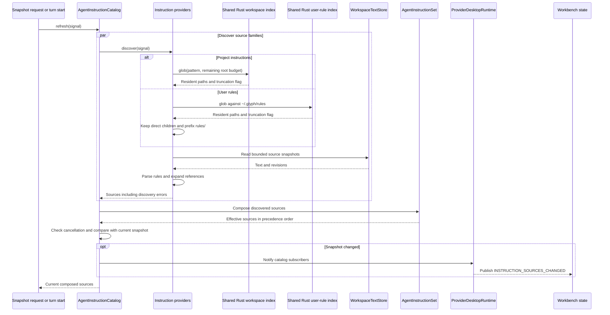
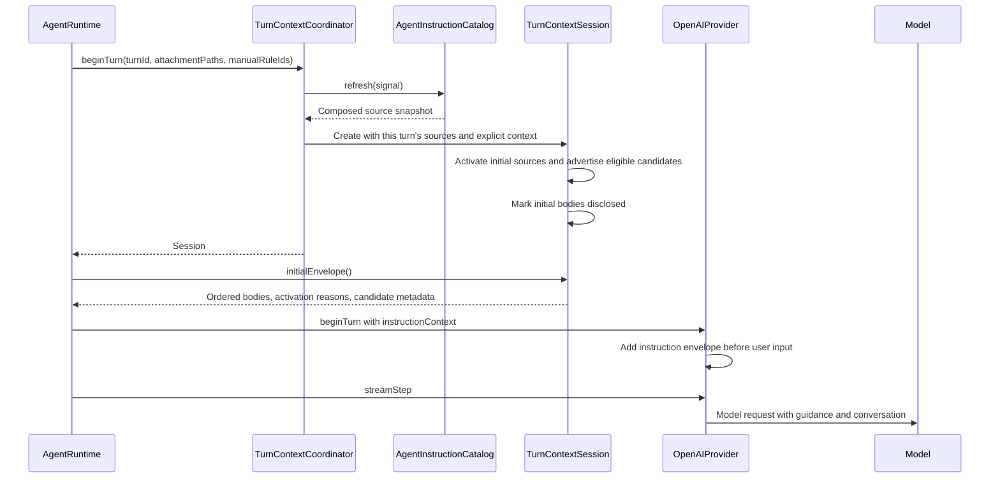
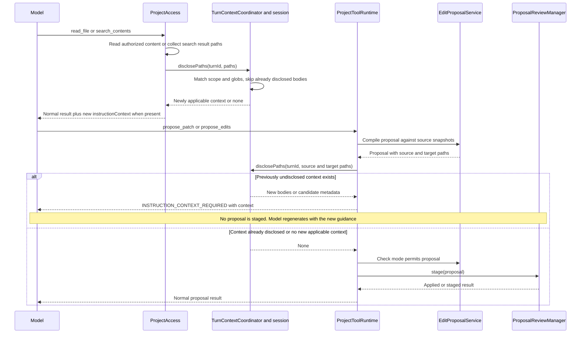
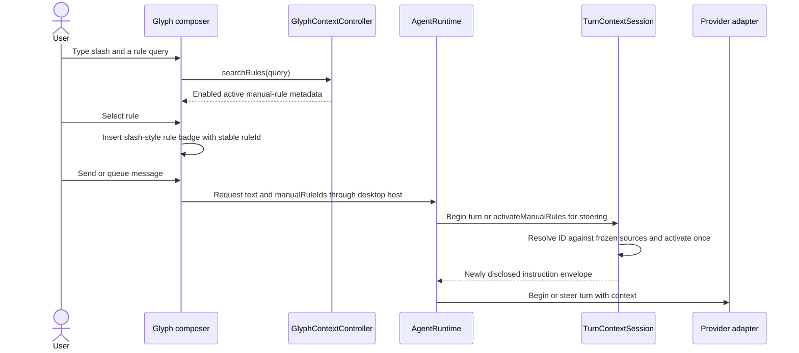
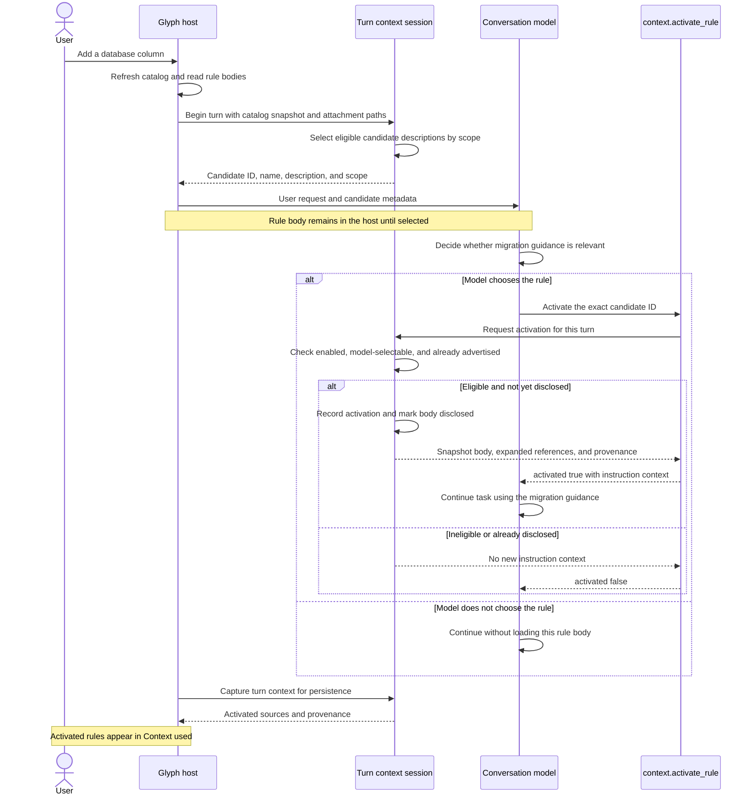
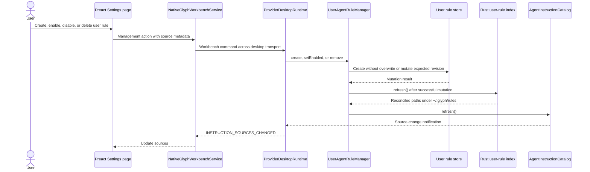
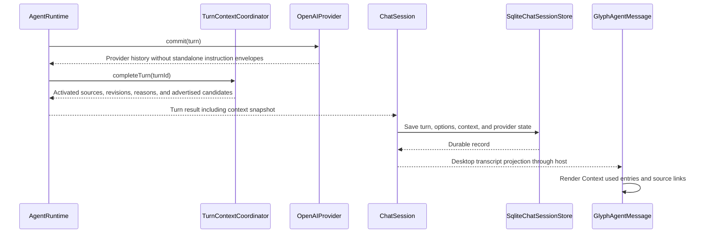

# Agent instructions

Glyph discovers instruction paths through Rust indexes and reads their contents through policy-aware workspace stores, composes them into a catalog, and selects applicable guidance for each logical agent turn. Discovery reads files into the host catalog; it does **not** send every discovered body to the model. A turn session owns activation and disclosure so a source selected through several paths contributes its body only once during that turn.

The sequences below follow the current desktop implementation. Discovery, turn coordination, project tools, and persistence run in the utility host. The Settings page and composer run in the Code OSS renderer. Model-specific message construction belongs to the provider adapter. The [agent editing walkthrough](AGENT_EDITING.md) continues the mutation path after instruction checks allow a proposal to be staged.

## Sources and ownership

| Owner                                                                                     | Responsibility                                                                                                                                                   |
| ----------------------------------------------------------------------------------------- | ---------------------------------------------------------------------------------------------------------------------------------------------------------------- |
| [AgentsMdInstructionProvider](../src/instructions/AgentsMdInstructionProvider.ts)         | Discover and read directory-scoped `AGENTS.md` files.                                                                                                            |
| [AgentRuleInstructionProvider](../src/instructions/rules/AgentRuleInstructionProvider.ts) | Discover `.mdc` rules, parse activation metadata, expand references, and calculate revisions.                                                                    |
| [AgentInstructionSet](../src/instructions/AgentInstructionSet.ts)                         | Compose source families, suppress compatibility duplicates, order precedence, and resolve ancestors. This value object has no discovery lifecycle or turn state. |
| [AgentInstructionCatalog](../src/instructions/AgentInstructionCatalog.ts)                 | Refresh providers, retain the composed result, and notify subscribers when it changes.                                                                           |
| [TurnContextCoordinator](../src/context/turns/TurnContextCoordinator.ts)                  | Create, address, and release sessions by logical turn ID.                                                                                                        |
| [TurnContextSession](../src/context/turns/TurnContextSession.ts)                          | Retain the turn's source snapshot, activate applicable sources, track disclosed bodies, and record provenance.                                                   |
| [UserAgentRuleManager](../src/instructions/rules/UserAgentRuleManager.ts)                 | Create, enable, disable, and delete user rules through revision-guarded storage.                                                                                 |

[OpenAIDesktopRuntimeFactory](../src/desktop/host/OpenAIDesktopRuntimeFactory.ts) constructs these services for trusted workspaces and shares the coordinator with the provider and project tools. It registers four source families:

| Family                   | Discovery location       | Scope                                                            |
| ------------------------ | ------------------------ | ---------------------------------------------------------------- |
| Repository guidance      | `**/AGENTS.md`           | The directory containing the file and its descendants.           |
| Native project rules     | `**/.glyph/rules/*.mdc`  | The directory containing `.glyph` and its descendants.           |
| Compatible project rules | `**/.cursor/rules/*.mdc` | The directory containing `.cursor` and its descendants.          |
| User rules               | `~/.glyph/rules/*.mdc`   | Workspace-wide; reads use a separate store rooted at `~/.glyph`. |

Project discovery uses [listInstructionFilesAcrossRoots](../src/instructions/listInstructionFilesAcrossRoots.ts). It queries each root's existing [RustWorkspacePathIndex](../src/context/search/RustWorkspacePathIndex.ts) through the host-neutral `WorkspacePathIndex.glob()` port, enforces one result limit across roots, and prefixes paths with the root name in multi-root workspaces. Each source family queries the resident path catalog; catalog refreshes do not start new workspace walks. Discovery inherits the index's Git-ignore rules, access-policy exclusions, and no-symlink traversal policy. Hidden `.glyph` and `.cursor` directories remain eligible unless ignored. Project bodies are read through the workspace store, which can supply live editor text; the user-rule store reads disk files. All paths still pass through the relevant store's access policy.

User-rule discovery uses a separate Rust index rooted at `~/.glyph/rules`. The host factory creates it lazily for trusted workspaces, shares it across workspace runtimes, and disposes it when the factory stops. [listUserRuleFiles](../src/instructions/rules/listUserRuleFiles.ts) retains direct `.mdc` children and translates index-relative paths back into the user store's `rules/` namespace. The index never traverses sibling directories under `~/.glyph`. Git-ignore filtering is disabled for this user-owned directory to preserve the previous behavior; native access-policy exclusions and symlink filtering still apply. File bodies and explicit references continue to be read through the separate store rooted at `~/.glyph`.

Composition orders sources by scope depth, then by source family, then by path. `.` has depth zero. At equal depth, the family order is user rules, Cursor-compatible rules, Glyph project rules, and `AGENTS.md`. Later entries have higher intended precedence. This order guides instruction interpretation; it does not merge contradictory prose or grant filesystem authority.

A Glyph project rule shadows a Cursor rule with the same name and scope. A source without a name uses its path as the compatibility key; successfully parsed rules normally receive a name from their filename. Shadowing happens before activation filtering and applies even when the native source is disabled or has an error. Disabling a native rule therefore does not silently enable its compatible counterpart. Different scopes remain independent. Errors and disabled native sources remain in the composed catalog for inspection.

`AgentInstructionSet.forPath()` selects successfully read ancestors using scope buckets built once during composition. Each lookup visits only the target's ancestor scopes and returns their sources in precedence order, avoiding a full catalog scan. It does not evaluate rule globs or enablement; those are turn activation decisions. The catalog's `resolve()` method delegates to this scope-selection behavior.

## Discovery, parsing, and refresh



Refreshes occur on desktop snapshot requests, at turn start, after managed user-rule mutations, and after a run finishes. The Settings component renders the host catalog; it does not scan files independently. The Rust indexes watch project and user-rule path changes; newly created or removed instruction files become visible after its watcher reconciles them and the catalog refreshes. Existing file bodies are read again on catalog refresh, including live editor text. There is no separate instruction-catalog watcher, and ordinary catalog refresh does not force a native index rescan. Successful Settings mutations explicitly refresh the user-rule index before refreshing the catalog, so changes appear before the operation returns rather than waiting for watcher reconciliation.

The rule parser accepts a small YAML-compatible frontmatter subset, not arbitrary YAML. Supported fields are `name`, `description`, `activation`, `alwaysApply`, `globs`, `enabled`, and `references`. Explicit `activation` wins. Otherwise `alwaysApply: true` selects `always`, nonempty globs select `file_pattern`, a description selects `model`, and the remaining case selects `manual`. A Markdown body without frontmatter is therefore a manual rule. Description length is capped at 2,000 characters. Glob matching supports `*`, `**`, and `?`; unsupported constructs are rejected.

References are explicit frontmatter paths resolved relative to the owning rule's scope. Nested references continue to use that same scope. The provider parses each referenced file and appends its body and nested references in traversal order. It detects cycles along the current reference chain and limits traversal depth to 16; repeated references on separate branches are not globally deduplicated. The effective `revision` hashes the rule revision together with referenced revisions. `sourceRevision` identifies only the rule file, allowing Settings to guard edits without confusing reference changes with changes to that file.

Both providers default to 10,000 discovery results and 64 KiB per file read. An oversized or unreadable file becomes an error source, not truncated guidance. These limits do not bound the total expanded body or the total instruction tokens in a turn. A TODO at the rule read boundary calls for revisiting the per-file, expanded-reference, and per-turn budgets together.

## Starting a turn



Initial activation follows these rules:

| Source                           | Initial activation                                                                                               |
| -------------------------------- | ---------------------------------------------------------------------------------------------------------------- |
| Root `AGENTS.md` with scope `.`  | Included automatically.                                                                                          |
| Nested or multi-root `AGENTS.md` | Included when an attachment path lies in its scope.                                                              |
| `always` rule                    | Included when scope is `.` or an initial attachment participates in its scope.                                   |
| `file_pattern` rule              | Included when an attachment matches both scope and glob.                                                         |
| `manual` rule                    | Included when its stable ID is explicitly selected.                                                              |
| `model` rule                     | Only name, ID, description, and scope are advertised when its scope participates. Its body waits for activation. |

Inactive, disabled, or missing sources cannot activate. Later file access can activate scoped `AGENTS.md` and file-pattern rules and advertise additional model candidates. The current later-access path does not activate scoped `always` rules that missed initial participation; it should not be mistaken for an unconditional directory-entry hook.

The session retains the source objects from the turn-start catalog. Later catalog refreshes replace the catalog view without changing this turn's bodies or revisions. The next logical turn refreshes and reevaluates its own sources. Activation records retain the first trigger and its paths; subsequent matches do not add another body or replace that first reason.

[OpenAIProvider](../src/providers/openai/OpenAIProvider.ts) wraps the envelope in a separate user-role message with schema `glyph.agent-instructions.v1`. Host and mode instructions remain separate. The envelope explicitly states that file guidance cannot grant tools, permissions, workspace access, or override host and user safety policy.

## Reads, searches, and mutation fallback



A previous read or content search counts as exposure for that logical turn. Editing the same scope therefore normally needs no additional instruction exchange. Plain `list_files` returns paths without calling the disclosure hook. Source and destination paths are both considered for structural changes, so a move into a new scope can discover destination guidance before staging.

The fallback is an internal tool result, not a user approval request. It asks the model to regenerate the proposal with newly disclosed context; it does not automatically replay compiled edits. Because candidate metadata also constitutes new context, a newly advertised model rule can cause this fallback even before its body is selected. Once staging is allowed, the normal revision, mode, trust, and review safeguards still apply. Instruction activation itself authorizes no mutation.

## Manual and model-selected rules



The slash picker reads the renderer's catalog projection and does no file search. `@` searches files and folders. Selection produces an atomic rule badge using the skill badge presentation. The prompt's text projection preserves `/RuleName`; the stable identity travels separately in `manualRuleIds`. Rule badges are removed from captured-file attachments and attachment spans. A typed string alone is not a trusted rule selection.

Queued sends and retries use the same composer document path. If a selected rule has disappeared or become ineligible before the next turn refresh, its ID does not activate it. Steering during a live turn uses that turn's frozen catalog and disclosure ledger, including any new attachment paths. A new turn gets a fresh ledger.

## How model-selected rules work

A model-selected rule is optional guidance that the agent chooses to load while answering the user's request. Glyph sends the agent a short description first. The same model handling the conversation decides whether the guidance is relevant and requests its full text through a tool. There is no separate classifier, embedding search, or additional model call to rank the rules.

For example, `.glyph/rules/database-migrations.mdc` could contain:

```mdc
---
name: Database migrations
activation: model
description: Use when adding or changing database schemas, migrations, or backfills.
---
Keep schema changes compatible with the currently deployed application.
Separate large data backfills from schema migrations.
Describe the rollback strategy and test migration behavior.
```

When the user asks to add a database column, the flow is:



For this example, the tool arguments are `{"id":"glyph_project_rule:.glyph/rules/database-migrations.mdc"}`. The model copies the ID supplied in the candidate metadata; it does not construct a path or search for the file itself. Repeated activation requests do not resend the body during that turn.

The description is therefore the selection cue: describe **when the rule should be used**. Detailed requirements belong in the body. Choosing `activation: model` without a nonempty description does not produce a candidate. A description also implies model selection when activation is omitted and neither `alwaysApply: true` nor file globs selects another mode.

Directory scope still controls visibility. A workspace-root rule can be advertised immediately. A rule under `packages/api/.glyph/rules/` becomes a candidate only when an attachment or subsequent file access brings a path in `packages/api` into the turn. Glyph then includes its description in that context update; the model can choose it at that point. Merely mentioning “API” in the user's prose does not bypass this path-based scope check.

Selection is discretionary: the agent may decide not to call the tool, in which case Glyph does not disclose that rule's body through activation. Use `always` for automatic inclusion when the rule's scope participates, or `file_pattern` for automatic inclusion on matching file paths. Every new turn reevaluates candidates from a fresh snapshot; prior activation is not a permanent enablement choice. The provider-history caveat under persistence below still applies to bodies returned in earlier tool results.

The activation tool is available in Agent and Plan modes and requires an active turn ID. It cannot activate arbitrary files or use the model route to activate a manual-only rule. Candidate descriptions are individually bounded; the current session does not impose a separate aggregate candidate-token budget.

## Settings and user-rule management

The native Preferences pane [GlyphAgentInstructionsPreferences](../code-oss/overlay/src/vs/workbench/contrib/glyph/browser/GlyphAgentInstructionsPreferences.ts) mounts [GlyphAgentInstructions](../code-oss/ui/GlyphAgentInstructions/GlyphAgentInstructions.presentational.tsx), a Preact component with [Storybook stories](../code-oss/ui/GlyphAgentInstructions/GlyphAgentInstructions.stories.tsx). The pane supplies Settings search text and current host sources. The UI shows source scope, activation metadata, enablement, and errors; catalog availability is distinct from activation in a particular turn.



Creation derives a safe filename and writes a template beneath `~/.glyph/rules`. Enable/disable and delete use `managementPath` and `managementRevision`, derived from the user rule's original source revision. A stale edit fails instead of overwriting newer text. The manager restricts mutations to direct `rules/*.mdc` children of its user store. Project rules are opened in the editor for normal file editing; these management commands do not grant arbitrary project or home-directory writes.

## Completion, provenance, and history



The completed turn's context is persisted separately from user text. SQLite validates the stored context structure on load. This record preserves the activated source content and revisions even if the catalog changes later. The desktop projects provenance into the assistant message's “Context used” inspector. Its source link resolves through the current catalog and opens the current file; it is not a historical-content editor and can fail if that source is no longer available.

Provider commit removes standalone instruction-envelope messages. Instruction contexts inside tool results remain part of tool history; this filtering is not a guarantee that every old instruction body disappears from subsequent provider input. Durable provenance is also separate from provider history compaction. Activation decisions for the next turn are recomputed from a fresh catalog regardless of what older tool output remains in history.

Failed or cancelled turns release their live session in `finally` and do not return a completed context snapshot. Ordinary tool intent/outcome checkpoints still retain their own provider state. The coordinator retains at most 32 live sessions, evicting the oldest entry if that bound is exceeded.

The main behavior coverage lives in the [catalog tests](../src/instructions/tests/AgentInstructionCatalog.test.ts), [composition tests](../src/instructions/tests/AgentInstructionSet.test.ts), [turn-context tests](../src/context/turns/tests/TurnContextCoordinator.test.ts), rule provider/manager tests under `src/instructions/rules/tests`, and [desktop rule acceptance tests](../code-oss/tests/electron/GlyphRules.test.mjs). The [Rule Picker story](../code-oss/ui/GlyphComposer/GlyphComposer.stories.tsx) exercises slash selection alongside the Settings stories.
