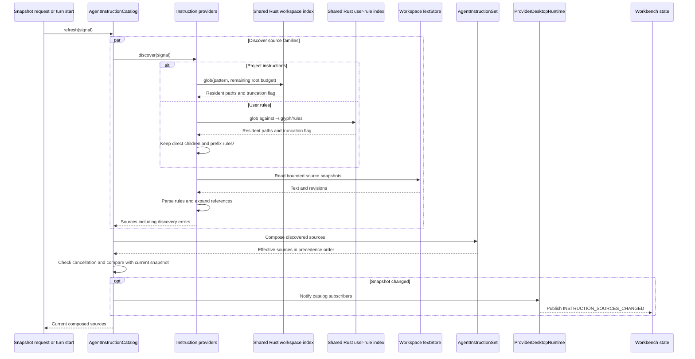
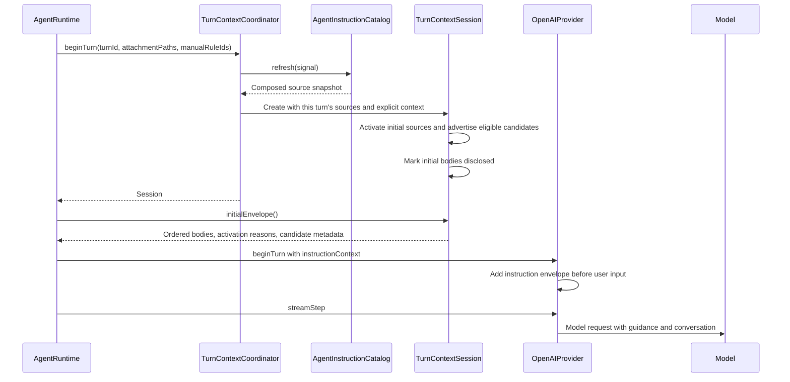
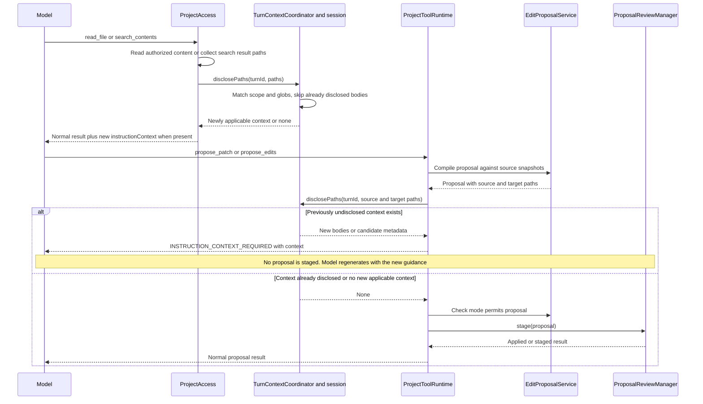
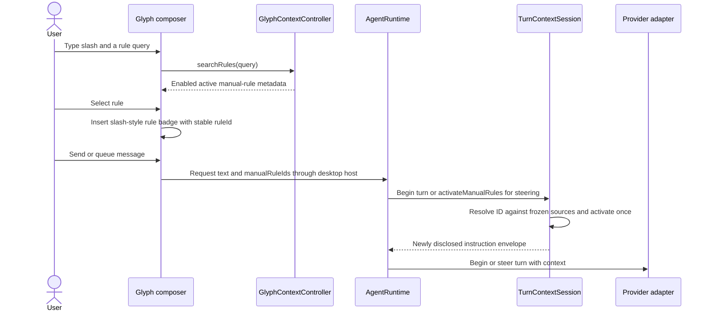
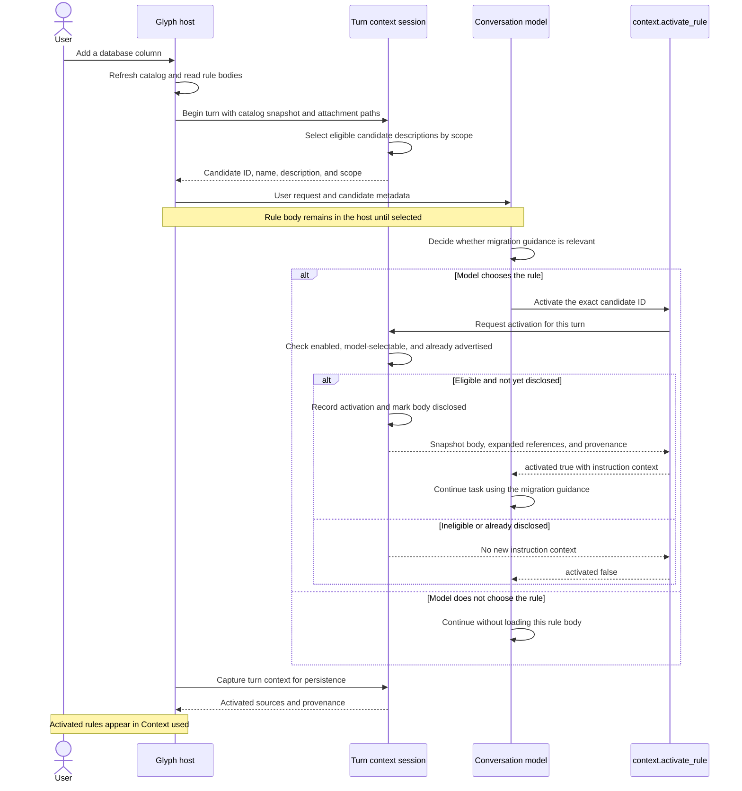
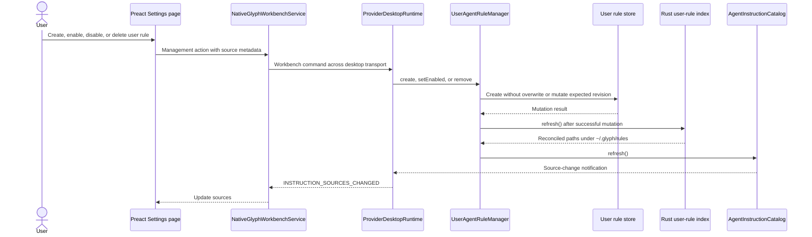
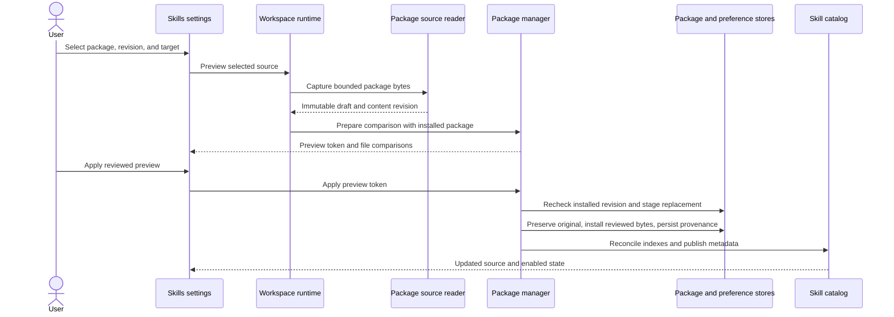
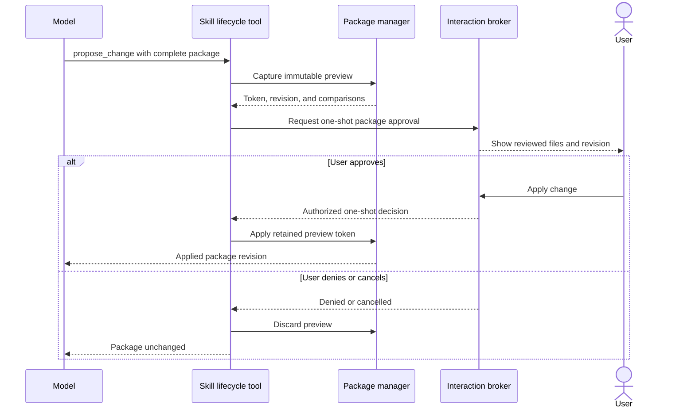
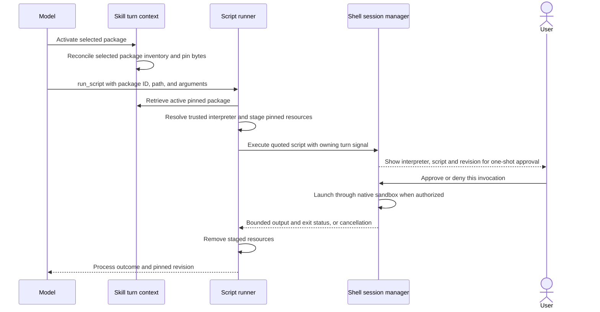
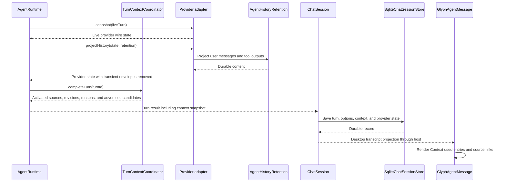

# Agent instructions

Glyph discovers instruction paths through Rust indexes and reads their contents through policy-aware workspace stores, composes them into a catalog, and selects applicable guidance for each logical agent turn. Discovery reads files into the host catalog; it does **not** send every discovered body to the model. A turn session owns activation and disclosure so a source selected through several paths contributes its body only once during that turn.

The sequences below follow the current desktop implementation. Discovery, turn coordination, project tools, and persistence run in the utility host. The Settings page and composer run in the Code OSS renderer. Model-specific message construction belongs to the provider adapter. The [agent editing walkthrough](AGENT_EDITING.md) continues the mutation path after instruction checks allow a proposal to be staged.

## Sources and ownership

| Owner                                                                                     | Responsibility                                                                                                                                                   |
| ----------------------------------------------------------------------------------------- | ---------------------------------------------------------------------------------------------------------------------------------------------------------------- |
| [AgentsMdInstructionProvider](../src/instructions/AgentsMdInstructionProvider.ts)         | Discover and read directory-scoped `AGENTS.md` files.                                                                                                            |
| [AgentRuleInstructionProvider](../src/instructions/rules/AgentRuleInstructionProvider.ts) | Discover `.mdc` rules, parse activation metadata, expand references, and calculate revisions.                                                                    |
| [AgentInstructionSet](../src/instructions/AgentInstructionSet.ts)                         | Compose source families, suppress compatibility duplicates, order precedence, and resolve ancestors. This value object has no discovery lifecycle or turn state. |
| [AgentInstructionCatalog](../src/instructions/AgentInstructionCatalog.ts)                 | Refresh providers, retain the composed result, and notify subscribers when it changes.                                                                           |
| [TurnContextCoordinator](../src/context/turns/TurnContextCoordinator.ts)                  | Create, address, and release sessions by logical turn ID.                                                                                                        |
| [TurnContextSession](../src/context/turns/TurnContextSession.ts)                          | Retain the turn's source snapshot, activate applicable sources, track disclosed bodies, and record provenance.                                                   |
| [UserAgentRuleManager](../src/instructions/rules/UserAgentRuleManager.ts)                 | Create, enable, disable, and delete user rules through revision-guarded storage.                                                                                 |

[OpenAIDesktopRuntimeFactory](../src/desktop/host/OpenAIDesktopRuntimeFactory.ts) constructs these services for trusted workspaces and shares the coordinator with the provider and project tools. It registers four source families:

| Family                   | Discovery location       | Scope                                                            |
| ------------------------ | ------------------------ | ---------------------------------------------------------------- |
| Repository guidance      | `**/AGENTS.md`           | The directory containing the file and its descendants.           |
| Native project rules     | `**/.glyph/rules/*.mdc`  | The directory containing `.glyph` and its descendants.           |
| Compatible project rules | `**/.cursor/rules/*.mdc` | The directory containing `.cursor` and its descendants.          |
| User rules               | `~/.glyph/rules/*.mdc`   | Workspace-wide; reads use a separate store rooted at `~/.glyph`. |

Project discovery uses [listInstructionFilesAcrossRoots](../src/instructions/listInstructionFilesAcrossRoots.ts). It queries each root's existing [RustWorkspacePathIndex](../src/context/search/RustWorkspacePathIndex.ts) through the host-neutral `WorkspacePathIndex.glob()` port, reserves each attached root’s top-level `AGENTS.md` lookup before distributing the remaining nested-discovery budget, and qualifies paths by root in multi-root workspaces. Each source family queries the resident path catalog; catalog refreshes do not start new workspace walks. Discovery inherits the index's Git-ignore rules, access-policy exclusions, and no-symlink traversal policy. Hidden `.glyph` and `.cursor` directories remain eligible unless ignored. Automatic project reads use a descriptor-validated disk snapshot. An existing dirty working copy can supply text after its file identity is checked. These reads never open a new editor model. The user-rule store reads disk files under its own access policy.

User-rule discovery uses a separate Rust index rooted at `~/.glyph/rules`. The host factory creates it lazily for trusted workspaces, shares it across workspace runtimes, and disposes it when the factory stops. [listUserRuleFiles](../src/instructions/rules/listUserRuleFiles.ts) retains direct `.mdc` children and translates index-relative paths back into the user store's `rules/` namespace. The index never traverses sibling directories under `~/.glyph`. Git-ignore filtering is disabled for this user-owned directory to preserve the previous behavior; native access-policy exclusions and symlink filtering still apply. File bodies and explicit references continue to be read through the separate store rooted at `~/.glyph`.

Composition orders sources by scope depth, then by source family, then by path. `.` has depth zero. At equal depth, the family order is user rules, Cursor-compatible rules, Glyph project rules, and `AGENTS.md`. Later entries have higher intended precedence. This order guides instruction interpretation; it does not merge contradictory prose or grant filesystem authority.

A Glyph project rule shadows a Cursor rule with the same name and scope. A source without a name uses its path as the compatibility key; successfully parsed rules normally receive a name from their filename. Shadowing happens before activation filtering and applies even when the native source is disabled or has an error. Disabling a native rule therefore does not silently enable its compatible counterpart. Different scopes remain independent. Errors and disabled native sources remain in the composed catalog for inspection.

`AgentInstructionSet.forPath()` selects successfully read ancestors using scope buckets built once during composition. Each lookup visits only the target's ancestor scopes and returns their sources in precedence order, avoiding a full catalog scan. It does not evaluate rule globs or enablement; those are turn activation decisions. The catalog's `resolve()` method delegates to this scope-selection behavior.

An unreadable root `AGENTS.md` blocks upfront instruction admission for that root. An unreadable nested file affects its own scope. Glob evaluation shares a four-million-step budget per disclosure, handles literal paths directly, and evaluates each distinct pattern once for a given path.

## Discovery, parsing, and refresh



Refreshes occur on desktop snapshot requests, at turn start, after managed user-rule mutations, and after a run finishes. Opening or searching Agent Instructions requests a fresh catalog. Overlapping discoveries publish in generation order, so earlier reads cannot replace a newer published snapshot. The Rust indexes watch project and user-rule path changes; newly created or removed instruction files become visible after its watcher reconciles them and the catalog refreshes. Existing file bodies are read again on catalog refresh, including live editor text. The workbench observes relevant file and dirty-model changes, the exact skill-state file, and dependencies from failed reference reads. It debounces events and repeats a targeted refresh when another change arrives during discovery. Open settings and pickers receive the updated catalog through the existing connection.

The rule parser accepts a small YAML-compatible frontmatter subset, not arbitrary YAML. Supported fields are `name`, `description`, `activation`, `alwaysApply`, `globs`, `enabled`, and `references`. Explicit `activation` wins. Otherwise `alwaysApply: true` selects `always`, nonempty globs select `file_pattern`, a description selects `model`, and the remaining case selects `manual`. A Markdown body without frontmatter is therefore a manual rule. Description length is capped at 2,000 characters. A rule can specify up to 64 globs of up to 512 characters each. The matcher supports `*`, `**`, and `?` and uses the target workspace folder’s filesystem casing.

References are explicit frontmatter paths resolved relative to the owning rule's scope. Nested references continue to use that same scope. The provider parses each referenced file and appends its body and nested references in traversal order. Resolution stays in the workspace folder that owns the rule. The provider detects cycles, caps a chain at 16 levels, and reuses parsed references within one rule. Each occurrence counts toward the edge and output limits. The effective `revision` hashes the rule revision together with referenced revisions. `sourceRevision` identifies only the rule file, allowing Settings to guard edits without confusing reference changes with changes to that file.

Each source family reads up to 10,000 listed files in index order, with a 64 KiB limit per file and an 8 MiB total read allowance. Rule discovery allows 8,192 reference edges and 8 MiB of expanded text per family. A single rule can consume up to 128 edges and 256 KiB of expanded text. A rule exceeding a limit appears in Settings with an error. A turn can disclose 512 KiB of serialized rule and AGENTS.md context, including candidate metadata. An over-budget disclosure fails before the session records those instructions as seen.

## Starting a turn



Initial activation follows these rules:

| Source                     | Initial activation                                                                                               |
| -------------------------- | ---------------------------------------------------------------------------------------------------------------- |
| Workspace-root `AGENTS.md` | Included at the start of every turn for each attached workspace folder.                                          |
| Nested `AGENTS.md`         | Included when an attachment path lies in its scope.                                                              |
| `always` rule              | Included when scope is `.` or an initial attachment participates in its scope.                                   |
| `file_pattern` rule        | Included when an attachment matches both scope and glob.                                                         |
| `manual` rule              | Included when its stable ID is explicitly selected.                                                              |
| `model` rule               | Only name, ID, description, and scope are advertised when its scope participates. Its body waits for activation. |

Later file access or a steering attachment can activate scoped `AGENTS.md`, scoped `always` rules, and matching file-pattern rules. These paths also make additional model candidates available.

The session retains the source objects from the turn-start catalog. Later catalog refreshes replace the catalog view without changing this turn's bodies or revisions. The next logical turn refreshes and reevaluates its own sources. Activation records retain the first trigger and its paths; subsequent matches do not add another body or replace that first reason.

[OpenAIProvider](../src/providers/openai/OpenAIProvider.ts) wraps the envelope in a separate user-role message with schema `glyph.agent-instructions.v1`. Host and mode instructions remain separate. The envelope explicitly states that file guidance cannot grant tools, permissions, workspace access, or override host and user safety policy.

## Reads, searches, and mutation fallback



The model must issue each project mutation in its own tool round. A previous read or content search counts as exposure for that logical turn. Editing the same scope therefore normally needs no additional instruction exchange. Plain `list_files` returns paths without calling the disclosure hook. Source and destination paths are both considered for structural changes, so a move into a new scope can discover destination guidance before staging.

The fallback is an internal tool result, not a user approval request. It asks the model to regenerate the proposal with newly disclosed context; it does not automatically replay compiled edits. Because candidate metadata also constitutes new context, a newly advertised model rule can cause this fallback even before its body is selected. Once staging is allowed, the normal revision, mode, trust, and review safeguards still apply. Instruction activation itself authorizes no mutation.

## Manual and model-selected rules



The slash picker reads the renderer's catalog projection and does no file search. `@` searches files and folders. Selection produces an atomic rule badge using the skill badge presentation. The prompt's text projection preserves `/RuleName`; the stable identity travels separately in `manualRuleIds`. Rule badges are removed from captured-file attachments and attachment spans. A typed string alone is not a trusted rule selection.

Queued sends and retries use the same composer document path. If a selected rule has disappeared or become ineligible before the next turn refresh, its ID does not activate it. Steering during a live turn uses that turn's frozen catalog and disclosure ledger, including any new attachment paths. A new turn gets a fresh ledger.

## How model-selected rules work

A model-selected rule is optional guidance that the agent chooses to load while answering the user's request. Glyph sends the agent a short description first. The same model handling the conversation decides whether the guidance is relevant and requests its full text through a tool. There is no separate classifier, embedding search, or additional model call to rank the rules.

For example, `.glyph/rules/database-migrations.mdc` could contain:

```mdc
---
name: Database migrations
activation: model
description: Use when adding or changing database schemas, migrations, or backfills.
---
Keep schema changes compatible with the currently deployed application.
Separate large data backfills from schema migrations.
Describe the rollback strategy and test migration behavior.
```

When the user asks to add a database column, the flow is:



For this example, the tool arguments are `{"id":"glyph_project_rule:.glyph/rules/database-migrations.mdc"}`. The model copies the ID supplied in the candidate metadata; it does not construct a path or search for the file itself. Repeated activation requests do not resend the body during that turn.

The description is therefore the selection cue: describe **when the rule should be used**. Detailed requirements belong in the body. A model-selected rule requires a nonempty description. A file-pattern rule requires at least one glob. Settings reports missing conditions as source errors. A description also implies model selection when activation is omitted and neither `alwaysApply: true` nor file globs selects another mode.

Directory scope still controls visibility. A workspace-root rule can be advertised immediately. A rule under `packages/api/.glyph/rules/` becomes a candidate only when an attachment or subsequent file access brings a path in `packages/api` into the turn. Glyph then includes its description in that context update; the model can choose it at that point. Merely mentioning “API” in the user's prose does not bypass this path-based scope check.

Selection is discretionary: the agent may decide not to call the tool, in which case Glyph does not disclose that rule's body through activation. Use `always` for automatic inclusion when the rule's scope participates, or `file_pattern` for automatic inclusion on matching file paths. Every new turn reevaluates candidates from a fresh snapshot; prior activation is not a permanent enablement choice. The provider-history caveat under persistence below still applies to bodies returned in earlier tool results.

The activation tool is available in Agent and Plan modes and requires an active turn ID. It cannot activate arbitrary files or use the model route to activate a manual-only rule. The turn counts advertised candidate metadata toward its instruction byte allowance.

## Settings and user-rule management

The native Preferences pane [GlyphAgentInstructionsPreferences](../code-oss/overlay/src/vs/workbench/contrib/glyph/browser/GlyphAgentInstructionsPreferences.ts) mounts [GlyphAgentInstructions](../code-oss/ui/GlyphAgentInstructions/GlyphAgentInstructions.presentational.tsx), a Preact component with [Storybook stories](../code-oss/ui/GlyphAgentInstructions/GlyphAgentInstructions.stories.tsx). The pane supplies Settings search text and current host sources. The UI shows source scope, activation metadata, enablement, and errors; catalog availability is distinct from activation in a particular turn.



Creation collects the description or file globs required by the selected activation mode, derives a safe filename, and writes a template beneath `~/.glyph/rules`. Enable/disable and delete use `managementPath` and `managementRevision`, derived from the user rule's original source revision. A stale edit fails instead of overwriting newer text. The manager restricts mutations to direct `rules/*.mdc` children of its user store. Project rules are opened in the editor for normal file editing; these management commands do not grant arbitrary project or home-directory writes.

## Skill discovery and activation

Skills are packages containing `SKILL.md` and optional references, scripts, and assets. Project discovery uses the existing Rust indexes for `.glyph/skills` and the compatible `.cursor/skills` location. User discovery uses a separate, shared Rust index rooted at `~/.glyph/skills`. Each location supplies a [SkillDiscoveryProvider](../src/skills/SkillDiscoveryProvider.ts), so another compatibility location can be added independently of activation. Claude locations are reserved for a later compatibility provider.

Discovery reads bounded `SKILL.md` snapshots and retains validated metadata. The model catalog contains descriptions and stable IDs, with each ID qualified by its origin and package location. Same-name packages remain visible. The Skills page in native Settings lists the catalog and its errors; **Edit** opens the selected package's `SKILL.md` in a pinned VS Code editor tab. The slash picker combines manual rules and skills, preserving the selected package ID separately from ordinary file attachments.

[TurnContextCoordinator](../src/context/turns/TurnContextCoordinator.ts) prepares independent instruction and skill contributors for the same logical turn. Manual skill selections load during preparation. The model can select an advertised package with `skills.activate`, supplying its stable ID and a relevance explanation. Nested project candidates become visible when their scope participates through an attachment or file access. Candidate metadata is bounded to 50 entries and 32 KiB per turn; explicit user selections can address eligible packages beyond that advertised subset.

Activation captures a bounded package snapshot in the host. It verifies the directory generation, complete inventory and file revisions across two reads, then reconciles the selected revision before admission. This captures resource bytes, including binary assets, to keep later reads on the same package revision even if files change on disk. Only the instruction body enters model context at activation. `skills.read_resource` subsequently discloses an individual resource from that snapshot and records its revision in provenance. Reference prose is never recursively expanded into the model request. Reading a script returns its content. Execution uses the separate `skills.run_script` tool and the owning chat’s shell authorization boundary.

The snapshot permits at most 256 files, 1 MiB per file, and 8 MiB in aggregate. An activated instruction body and each disclosed resource have separate 64 KiB limits. Oversized or unavailable content produces an error rather than truncated guidance. Each turn permits at most 32 active skill packages. Rule disclosure has a separate cumulative 512 KiB turn budget. Skills and rules enforce their budgets independently; a combined turn budget remains a separate design decision.

Activated packages and resources appear in “Context used” and are validated when the transcript is persisted. Their bodies are retained as provenance while the shared history-retention policy removes host envelopes from replayed conversation state. Activation records describe which context was used; they do not certify that a workflow completed.

## Installing and managing skills

Settings → Skills lets the user choose a user or project installation target, create a package, import a local directory, or select an HTTPS repository and commit or tag. **Preview package** shows the complete file comparison before application. Local sources are read through a Rust index scoped to the selected package. The preview identifies the requested repository URL and the commit Git resolved. User-configured Git mirrors and credential helpers can participate in the fetch. Glyph uses a trusted Git installation to read objects at that commit with checkout and hooks disabled. Both sources preserve binary assets and pass the same metadata, path, file-count, and byte-budget validation. **Edit** opens `SKILL.md` in the native editor; saving valid metadata makes the package available to discovery.

[SkillPackageDraft](../src/skills/SkillPackageDraft.ts) captures the complete prospective package and a content revision. [SkillPackageManager](../src/skills/SkillPackageManager.ts) retains it behind an opaque preview token. Applying that token uses those captured bytes even if the import source changes after preview. Updates and removals also compare the complete installed package against the previewed revision. Collision checks, authoritative editor-versus-disk checks, and a bounded transaction inventory prevent replacement from discarding unsaved edits, excluded files, or unindexed resources. Publication retains the original until persistence succeeds. A durable journal records unfinished changes, which are recovered before catalog discovery. [NativeWorkspaceMutations](../src/workspace/NativeWorkspaceMutations.ts) binds each managed store to its physical root identity. The standalone Rust helper opens parent directories relative to verified descriptors to create each staging directory, write the previewed files and their modes, publish by exclusive rename, and remove retired directories. A concurrent ancestor replacement therefore cannot redirect those mutations through a symlink. A failed restoration preserves its backup and reports the recovery location. A catalog delivery failure after a successful mutation reports that the package changed successfully and requests a refresh.

Enablement is stored independently of package content in `~/.glyph/skill-state.json`, keyed by provider and package identity. The same file retains the installation source and its reviewed content revision. The factory shares committed preference maps across workspace runtimes. Shared preference updates notify the affected catalogs. Other processes observe changes to the exact state file. Passive discovery runs recovery only for an origin with a pending journal. Cleanup of a retired backup can be retried after a successful commit. Unreadable preferences disable skill availability until a later refresh succeeds. Transaction staging and profile state remain excluded from ordinary project reads, edits, indexing, and sandboxed shell access. `GLYPH_USER_DIRECTORY` relocates this user directory for managed installations and isolated acceptance fixtures; its default remains `~/.glyph`.



## Agent-proposed package changes

`skills.propose_change` accepts a complete draft or an installed skill identity to remove. It is available in Agent mode. The host captures a preview and presents a one-shot approval containing its file comparisons, origin, and revision. The approval shows the retained physical destination and whether it affects the project or the user profile, together with changed file digests and modes. Dirty working copies, including unsaved new files, must be saved or discarded first. Global user packages also consult connected trusted windows in the same profile. The approval belongs to the requesting run and cannot create a reusable permission grant. Ordinary project edit tools direct managed-package changes through this approval boundary. Denial and cancellation discard the proposal. Approval applies the retained token through the same manager used by Settings, including stale-preview checks and rollback behavior.



## Running bundled scripts

`skills.run_script` requires an activated package and a script beneath `scripts/`. The host selects `sh`, `python3`, or `node` from the script extension, validates the resource path and any declared tool constraints, and stages the pinned package bytes in a private temporary directory outside every workspace root. The admitted sandbox receives read-only access to that specific directory. Executable resources retain their executable bits; the staged resources remain unwritable. Arguments are quoted individually. The shell approval displays the resolved absolute interpreter path, script body and package revision. Glyph selects an executable outside the attached workspaces from a trusted installation. Compatibility prose remains visible package guidance; the host does not interpret arbitrary natural-language requirements as executable policy. Missing interpreters and nonzero process exits produce failed tool activities, with the exit status retained before verbose output. Project skills execute in their owning workspace root. User skills require an explicit `workspace_root_id` when several roots are available.

The runner delegates to the shell session manager for sandbox admission, output bounds, and cancellation. Each invocation requires a one-shot decision; transient staging paths neither consume stored grants nor create new reusable grants. Tool declarations narrow this execution path and cannot supply shell permission. Foreground execution belongs to the requesting chat and ends with its turn; staging is removed after the process settles or is cancelled. Process completion records an exit status and package revision. The model remains responsible for verifying the requested workflow’s deliverables before claiming success.

Sandboxed commands can read approved skill packages. Package changes use the Skills review flow, and private transaction contents stay hidden during execution. On Linux, workspace-write commands can update existing single-link regular files in place. The shell sees workspace names admitted at startup. Files with multiple hard links are omitted because another name can refer to private or managed content, including when dependencies share a package-store inode. Use the sandbox temporary directory for new build outputs and project edit tools to create, delete, rename, or atomically replace workspace files. On macOS, workspace directories and symbolic links retain their names during a sandboxed command. An explicit outside-sandbox approval runs with the user’s broader filesystem permissions.



Settings and slash searches request fresh catalog metadata. Native file and editor-model changes also schedule refreshes, and an open picker follows metadata change notifications. Activation reconciles only the selected package’s bounded inventory so newly added resources are included even when the workspace watcher is still catching up. Active turns retain their original snapshots; later turns apply catalog changes and saved enablement choices.

## Completion, provenance, and history



Trusted sessions retain the completed turn’s context separately from user text. Restricted windows can display ordinary conversation history. Instruction context and privileged tool payloads remain restricted to authorized recipients. SQLite validates the stored context structure on load. This record preserves the activated source content and revisions even if the catalog changes later. The desktop projects provenance into the assistant message's “Context used” inspector. Expand a source in the inspector to read the instructions and revision retained for that turn, even after a file changes or is deleted. Open current file resolves through the current catalog.

[AgentHistoryRetention](../src/chat/runtime/AgentHistoryRetention.ts) owns the persistence policy for all provider adapters. The runtime applies its projection at checkpoints and restoration, removing standalone host instruction messages and host-added envelopes from serialized tool outputs while retaining ordinary tool data. The live turn retains those instructions for subsequent tool rounds. Adapters locate protocol fields and preserve their ordering, call IDs, and opaque reasoning state. This also cleans older saved tool outputs before they are replayed. Completed-turn provenance remains separately available to the inspector, and activation decisions are recomputed from the next turn’s catalog.

Failed or cancelled turns release their live session in `finally` and do not return a completed context snapshot. Ordinary tool intent/outcome checkpoints still retain their own provider state. The coordinator reserves a slot before refreshing instructions. It keeps up to 32 live or starting turns and returns a retryable admission message when all slots are in use.

The main behavior coverage lives in the [catalog tests](../src/instructions/tests/AgentInstructionCatalog.test.ts), [composition tests](../src/instructions/tests/AgentInstructionSet.test.ts), [turn-context tests](../src/context/turns/tests/TurnContextCoordinator.test.ts), rule provider/manager tests under `src/instructions/rules/tests`, and [desktop rule acceptance tests](../code-oss/tests/electron/GlyphRules.test.mjs). The [Rule Picker story](../code-oss/ui/GlyphComposer/GlyphComposer.stories.tsx) exercises slash selection alongside the Settings stories.
