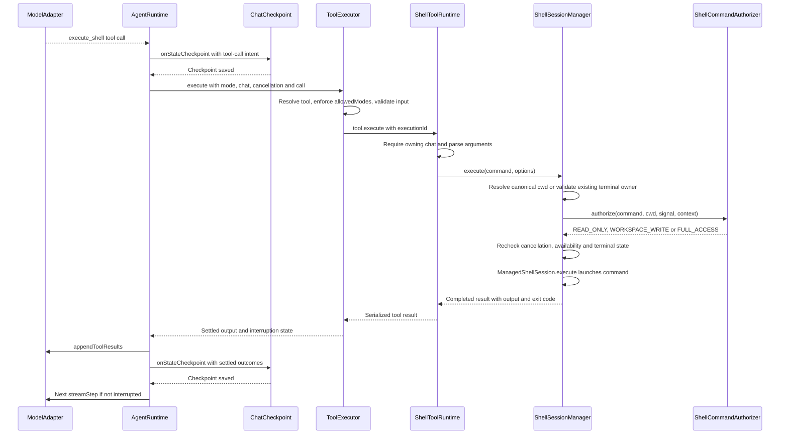
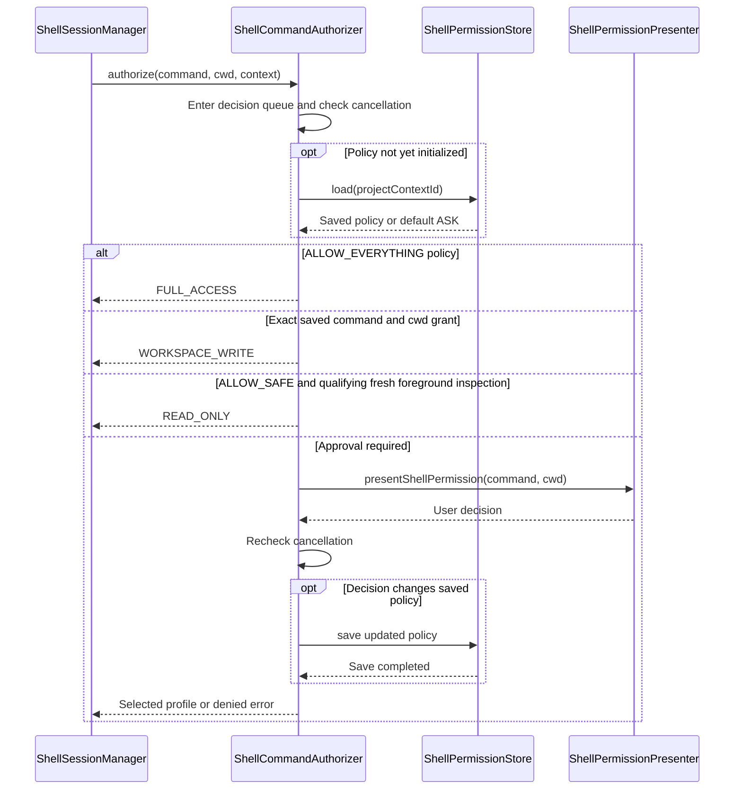
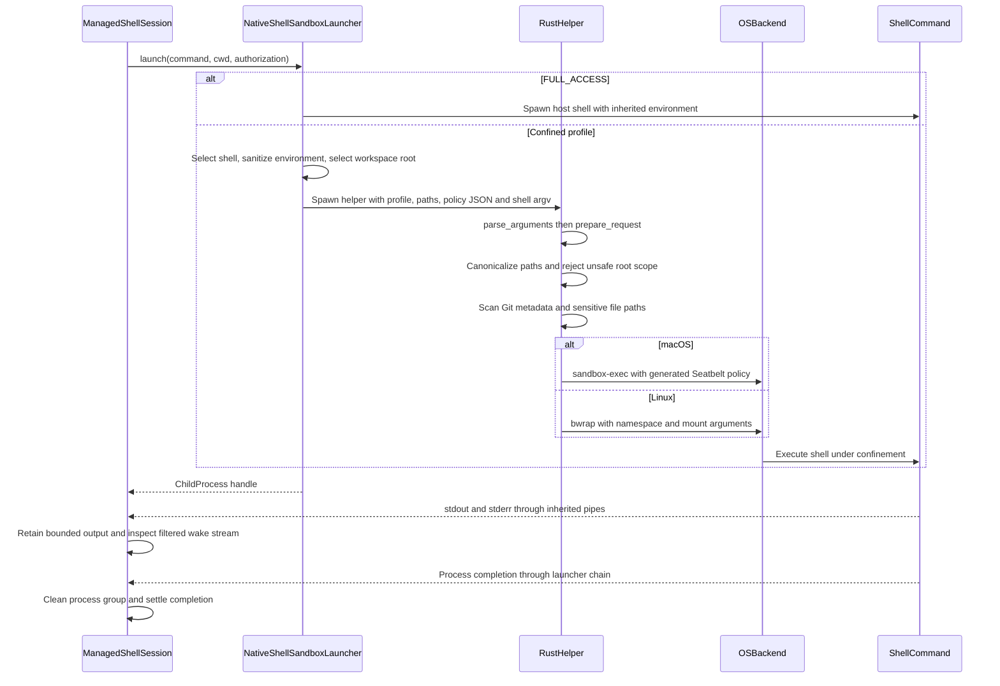

# Shell execution and sandbox policy

Glyph authorizes each shell command before launching it. Ordinary approval selects a confined execution profile; explicit outside-sandbox approval selects full access. The command classifier, approval policy, native confinement, and process lifecycle each enforce a different part of that contract.

This walkthrough describes source inspected on October 20, 2026. The shared checkout is active. No shell confinement probes or native integration tests were run to produce this document.

The first sequence follows one foreground `execute_shell` request. `AgentRuntime` checkpoints the tool-call intent before dispatch and the settled result before continuing the model turn. The configured checkpoint callback connects that runtime state to durable chat storage.

An existing terminal belongs to a chat and retains its working directory. Reusing an idle terminal starts another command through authorization; it does not reuse a permanently authorized login shell. `ShellWorkingDirectoryResolver` rejects absolute inputs and canonical paths escaping the selected project root. Multi-root workspaces require an explicit root name.

The second sequence expands authorization. `ShellCommandAuthorizer` serializes decisions, loads the project-scoped policy, and trims the command before matching it. A saved command grant matches both that complete command string and the resolved working directory.

The decision mapping is:

| Decision or policy                      | Profile                                                                                                   |
| --------------------------------------- | --------------------------------------------------------------------------------------------------------- |
| Allow once                              | `WORKSPACE_WRITE`                                                                                         |
| Always allow this command and directory | Persist exact grant, then `WORKSPACE_WRITE`                                                               |
| Allow safe commands                     | Persist `ALLOW_SAFE`; this command receives `READ_ONLY` only if it qualifies, otherwise `WORKSPACE_WRITE` |
| Allow outside sandbox once              | `FULL_ACCESS`                                                                                             |
| Allow everything                        | Persist `ALLOW_EVERYTHING`, then `FULL_ACCESS`                                                            |
| Deny                                    | No launch                                                                                                 |

`isSafeShellCommand()` recognizes a small set of simple inspection commands and rejects compound syntax and selected dangerous/sensitive arguments. Automatic safe approval excludes background commands and existing terminals. This classifier reduces approval prompts; it does not establish confinement.

The third sequence expands the launch and return path. `ManagedShellSession` is implemented inside `ShellSessionManager.ts`. The Rust helper is a child process outside the confined shell; it constructs the policy and waits for the OS backend.

For foreground commands, the manager waits with a default 120-second timeout and closes newly allocated terminals afterward. For background commands, the tool returns a `backgrounded` result before process completion; subsequent status/output and wake events belong to that terminal. A backgrounded tool result is evidence of launch, not command success.

Each stdout/stderr stream has its own `TerminalControlFilter` for wake matching. The command-result buffer and output tail retain bounded raw text; downstream presentation has separate sanitization. Closing a terminal disarms wake matching and initiates process cleanup. On Unix, cleanup targets the process group with SIGTERM and schedules SIGKILL after the grace period, independently of parent exit or pipe closure. This describes the implementation, not proof that every possible descendant remains in that group.

Interactive input requires a running command owned by the caller's chat. The implementation refuses raw input to `FULL_ACCESS` commands. Confined input remains inside the running command's existing sandbox.

Before either confined backend starts, `prepare_request()` resolves the working directory, state directory, workspace roots, and protected paths. It requires the working directory to belong to a root, rejects overlap between roots and the state directory, and rejects unsafe roots such as the filesystem root, the home directory or its ancestors, enumerated broad system directories, and paths overlapping known home-secret locations. The native request supports several roots, but the current TypeScript launcher passes the most specific configured root containing the command's working directory.

The launcher retains `HOME`, `USER`, `LOGNAME`, `LANG`, `TMPDIR`, and `LC_*` values, sets `SHELL`, `TERM=dumb`, and `NO_COLOR=1`, and omits other inherited variables. Read-only commands receive a fixed inspection `PATH`; workspace-write commands retain the host `PATH`. This changes executable lookup, not the OS filesystem grants.

The shell selector resolves an allowed shell name under enumerated system/package-manager directories or falls back to `/bin/sh`. Bash gets `--noprofile --norc`, zsh gets `-f`, and fish gets `--no-config`. These options suppress personal startup behavior; they should not be described as eliminating every system-level startup behavior.

The macOS implementation is `macos::seatbelt_policy()` in [lib.rs](../native/shell-sandbox/src/lib.rs). The helper creates a temporary directory, sets `TMPDIR` to it, and invokes `/usr/bin/sandbox-exec -p` with the generated policy. The process uses the host filesystem under resource-access restrictions; Glyph does not construct a substitute root filesystem on macOS.

| macOS policy area            | Rules generated by Glyph                                                                                                       |
| ---------------------------- | ------------------------------------------------------------------------------------------------------------------------------ |
| Default and network          | `(deny default)` and `(deny network*)`                                                                                         |
| Processes                    | Allow execution and fork; process information and signals are granted for `same-sandbox` targets                               |
| System queries               | Allow `sysctl-read`                                                                                                            |
| Service lookup               | Allow the six named Mach services listed below                                                                                 |
| Shared memory                | Allow `ipc-posix-shm`                                                                                                          |
| Device access                | Allow specified operations on `/dev/fd`, `/dev/random`, `/dev/urandom`, `/dev/null`, `/dev/tty`, and device metadata           |
| Reads                        | Recursive reads of the selected workspace, temporary directory, explicit system directories, and existing home toolchain paths |
| Writes in `READ_ONLY`        | Temporary directory and the specified device exceptions                                                                        |
| Writes in `WORKSPACE_WRITE`  | Add recursive workspace writes, subject to the explicit denials                                                                |
| State and identified secrets | Deny reads and writes at the configured state path, listed home-secret paths, and discovered sensitive workspace files         |
| Git and protected code       | Deny writes to `.git` path components, discovered Git metadata, supplied protected paths, and the helper executable            |

The recursive system read grants are `/System`, `/usr`, `/bin`, `/sbin`, `/Library`, `/private/etc`, `/private/var/db`, `/private/var/run`, `/private/var/select`, `/opt/homebrew`, and `/usr/local`. They are broad runtime/toolchain grants, not an executable-only allowlist. The separate literal `/` rule permits access to the root itself; it is not a recursive grant for all host files.

The Mach service names are `com.apple.bsd.dirhelper`, `com.apple.cfprefsd.agent`, `com.apple.cfprefsd.daemon`, `com.apple.CoreServices.coreservicesd`, `com.apple.system.logger`, and `com.apple.system.opendirectoryd.libinfo`. Mach lookup permits finding those service endpoints. Their presence means the sandbox is not isolated from every host service; it does not establish unrestricted access to every operation a service could perform.

The installed Apple manuals describe child inheritance and resource-access enforcement. They also mark `sandbox-exec` as deprecated. This implementation depends on that command; its lifecycle is separate from whether the generated policy is correct.

The Linux implementation is `linux::bubblewrap_arguments()` in [lib.rs](../native/shell-sandbox/src/lib.rs). Backend lookup tries `/usr/bin/bwrap` and `/bin/bwrap` and canonicalizes the first existing file. It does not search the inherited `PATH`.

| Linux construction                 | Effect intended by Glyph                                                                                            |
| ---------------------------------- | ------------------------------------------------------------------------------------------------------------------- |
| `--unshare-all`                    | Separate available namespaces, including network, IPC and PID                                                       |
| `--tmpfs /`                        | Start with a temporary root filesystem                                                                              |
| `--dev /dev`, `--proc /proc`       | Supply device and process filesystem views                                                                          |
| `--tmpfs /tmp`                     | Supply private temporary storage; set `TMPDIR=/tmp`                                                                 |
| `--ro-bind` system/toolchain paths | Expose selected host directories read-only                                                                          |
| Workspace mount                    | `--ro-bind` for `READ_ONLY`; `--bind` for `WORKSPACE_WRITE`                                                         |
| Metadata/protected overlays        | Remount discovered Git metadata and protected paths read-only when they lie inside a workspace root                 |
| Sensitive-file overlays            | Cover each discovered sensitive file with a read-only bind of `/dev/null`                                           |
| State overlay                      | Cover the configured state directory with a fresh tmpfs                                                             |
| Home-secret overlays               | If exposed within a workspace root, cover listed secret directories with tmpfs and files with read-only `/dev/null` |
| `--new-session`                    | Detach from the controlling terminal                                                                                |
| `--die-with-parent`                | Ask Bubblewrap to terminate sandbox processes if its parent dies                                                    |

The system read mounts, when present, are `/usr`, `/bin`, `/sbin`, `/lib`, `/lib64`, `/etc`, `/opt`, and `/nix/store`. Bind mounts expose host files, so writes through the workspace's writable mount affect the real checkout. Temporary root/state mounts are separate storage. Even `READ_ONLY` allows writes to private temporary storage; it is not a global prohibition on every write syscall.

Bubblewrap documents `--unshare-all` as including user and cgroup namespace attempts plus IPC, PID, network and UTS isolation. Glyph does not override it with `--share-net`. A network namespace separates the child from the host's network namespace; this is a different mechanism from Seatbelt's operation denial. A cgroup namespace does not by itself impose CPU or memory quotas. See the [upstream Bubblewrap option reference](https://github.com/containers/bubblewrap/blob/main/bwrap.xml).

Both backends add existing home toolchain paths from the same list: `.cargo/bin`, `.cargo/git`, `.cargo/registry`, `.rustup/toolchains`, `.local/bin`, `.volta`, `.nvm`, `.asdf`, `.bun/bin`, `.pnpm`, `Library/pnpm`, `Library/Application Support/fnm`, `.cache/fnm`, and `.cache/node/corepack`. These are readable directory trees, not just permission to execute one binary.

The shared home-secret list is `.ssh`, `.aws`, `.azure`, `.config/gcloud`, `.config/gh`, `.config/glab`, `.kube`, `.docker/config.json`, `.npmrc`, `.netrc`, `.pypirc`, `.git-credentials`, `Library/Keychains`, and `.local/share/keyrings`. macOS emits explicit denials. Linux generally leaves the rest of home unmounted and has the conditional masking rules above. Those conditional masks do not amount to validation of every auxiliary toolchain mount or alias.

Workspace-sensitive files come from the serialized [WorkspaceAccessPolicy](../src/workspace/policy/WorkspaceAccessPolicy.ts). The defaults identify `.git-credentials`, `.netrc`, `.npmrc`, `.pypirc`, names starting with `.env`, and names ending with `.key`, `.pem`, `.p12`, or `.pfx`. `.env.example` is exempt. The native matcher folds case.

The scanner examines existing regular files, skips symlinks, and does not descend into ignored directories. With the current TypeScript defaults these are `.artifacts`, `.code-oss`, `.git`, `.next`, `coverage`, `dist`, `node_modules`, and `target`. Each traversal is bounded to 100,000 entries and depth 64; exceeding a bound fails policy construction. Git pointer reads are limited to 4 KiB.

These are startup scans, not ongoing secret classification. Ignored directories are not automatically denied to the shell: they can remain readable, and writable under workspace-write, through the containing workspace grant. Later-created files, unrecognized names, and aliases are not covered merely because another pathname was classified as sensitive.

There are meaningful differences between the resulting policies:

- A detected secret read is denied on macOS; Linux presents the `/dev/null` replacement, normally yielding empty content. Both aim to withhold the original bytes, but callers observe different behavior.
- macOS has a `.git` write-denial regex as well as discovered metadata paths. Linux uses discovered mounts and has no equivalent persistent pathname rule for future `.git` entries.
- macOS explicitly permits selected host services and POSIX shared memory. Linux requests separate IPC/PID/network namespaces. These are not identical IPC boundaries.
- Glyph's Linux builder supplies no custom seccomp filter, CPU quota, memory quota, or process-count quota. The macOS builder likewise does not establish such resource budgets. Host timeouts, output caps and terminal limits are separate controls.
- Ordinary confined profiles have no network-enabled variant. A command needing host networking currently requires full-access authorization, which removes the shell confinement rather than only adding networking.

For `FULL_ACCESS`, `NativeShellSandboxLauncher` bypasses the Rust helper, retains the inherited environment, and starts the Unix shell with `-lc` or Windows `cmd.exe` with `/d /s /c`. This path remains subject to ordinary OS/user permissions. Unsupported native sandbox platforms and unavailable backends return failure; they do not automatically retry with full access.

Shell network isolation does not cover host web requests or provider calls. Any readable data returned as tool output can flow through the host to the model. Protection also depends on the helper/backend binaries, the kernel, mount sources, path identity and reachable host services. Policy construction alone is not evidence that every native boundary has been tested.

Source entry points:

- [AgentRuntime](../src/chat/runtime/AgentRuntime.ts), [ToolExecutor](../src/tools/ToolExecutor.ts), and [ShellToolRuntime](../src/shell/ShellToolRuntime.ts): intent checkpoint, mode gate and tool dispatch.
- [ShellSessionManager](../src/shell/ShellSessionManager.ts) and [ShellWorkingDirectoryResolver](../src/shell/ShellWorkingDirectoryResolver.ts): chat ownership, cwd selection, process/output lifecycle.
- [ShellCommandAuthorizer](../src/shell/ShellCommandAuthorizer.ts) and [isSafeShellCommand](../src/shell/isSafeShellCommand.ts): approval and profile choice.
- [NativeShellSandboxLauncher](../src/shell/NativeShellSandboxLauncher.ts): environment and native invocation.
- [Native main](../native/shell-sandbox/src/main.rs) and [policy builders](../native/shell-sandbox/src/lib.rs): request validation and OS confinement setup.
- [Desktop composition](../src/desktop/host/OpenAIDesktopRuntimeFactory.ts) supplies the artifact root as a protected path; [CLI composition](../src/cli.ts) supplies the package root and native helper paths. The helper adds its own executable.
